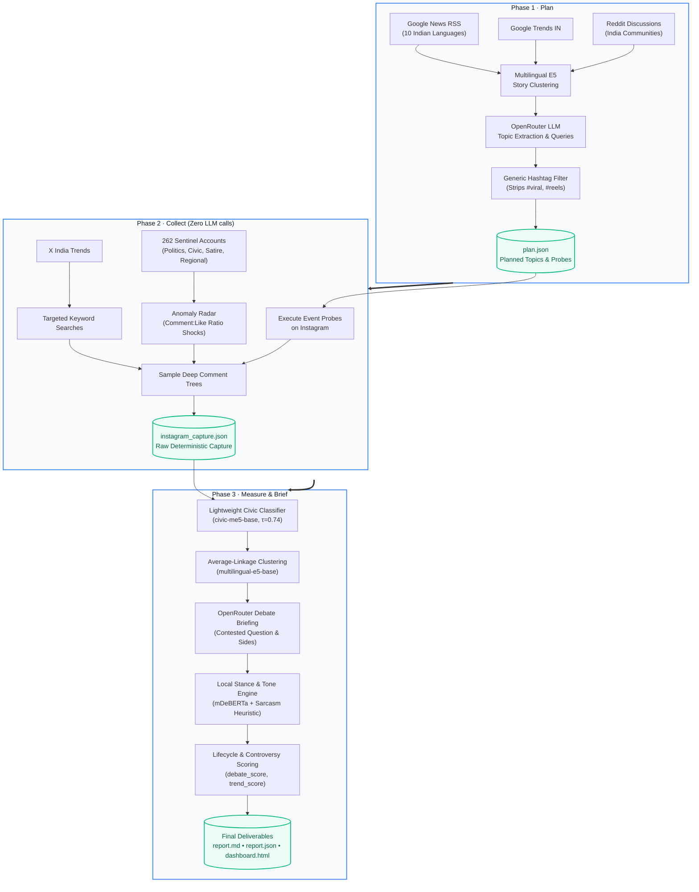

<div align="center">

# 🇮🇳 Identify What Matters

### Autonomous Real-Time Intelligence on Emerging Trends, Controversy & Grassroots Debates in India

[](https://python.org)
[](https://docs.astral.sh/uv/)
[](https://openrouter.ai/)
[](https://huggingface.co/intfloat/multilingual-e5-base)
[](tests/)
[](LICENSE)

<br/>

[🔍 Overview](#-system-overview) • [⚡ Quickstart](#-quickstart-in-60-seconds) • [⚙️ How It Works](#️-how-it-works) • [🚀 Running the Pipeline](#-running-the-pipeline) • [📊 Dashboards](#-interactive-dashboards) • [🤖 ML Stack](#-local-machine-learning-stack) • [📁 Codebase Map](#-codebase-directory-map)

---

</div>

> 💡 **The Problem:** Standard trend trackers rely on raw keyword frequencies and view counts. This surfaces viral reels, celebrity trivia, and PR campaigns while remaining completely blind to genuine civic friction, polarized controversies, and grassroots citizen debates.
> 
> 🎯 **The Solution:** A discussion-first, NLP-driven intelligence monitor. It measures comment-to-like ratio shocks, reply tree depth, multilingual code-mixed arguments, astroturf coordination, and opposing viewpoints across Indian social feeds (Instagram, Google News in 10 languages, Google Trends, X Trends, and Reddit), augmented by 12 trained political and demographic classifiers.

---

## 🌟 Key Capabilities

<table>
<tr>
<td width="50%" valign="top">

### ⚔️ Controversy & Debate Detection
Detects disagreement objectively through comment-to-like ratios, reply cascades, account baseline lifts, and like-weighted stance distribution between competing sides ($1 - |s_1 - s_2|$).

</td>
<td width="50%" valign="top">

### ⚡ Early Breakout Anomaly Radar
Catches breaking controversies in their earliest stages (`simmering` $\to$ `pre_breakout`) through velocity surges and cross-account spreading before stories reach mainstream press.

</td>
</tr>
<tr>
<td width="50%" valign="top">

### 🌐 Multilingual & Code-Mixed NLP
Fine-tuned `multilingual-e5-base` bi-encoder and `mDeBERTa` cross-encoder comprehend Hinglish, Tanglish, and regional Indian languages (Hindi, Tamil, Telugu, Bengali, Malayalam, etc.).

</td>
<td width="50%" valign="top">

### 🛡️ Astroturf & Bot Neutralization
Differentiates between authentic citizen discussions and coordinated bot campaigns using 5-shingle Jaccard comment duplication clustering and account behavior baselines.

</td>
</tr>
<tr>
<td width="50%" valign="top">

### 🏛️ Political Undercurrents & Issue Clusters
Classifies discussions across 13 civic/governance issue clusters (e.g. corruption, welfare, infrastructure, judicial friction), tracking net partisan favorability, target entities, and narrative framing.

</td>
<td width="50%" valign="top">

### 👥 Audience Demographics & Mindset
Infers audience demographic cohorts (age brackets, gender personas, regional origins) and psychological sentiment archetypes from conversational linguistic markers and ML classifiers.

</td>
</tr>
<tr>
<td width="50%" valign="top">

### 📋 Automated Intelligence Briefings
Synthesizes contested topics into objective briefs highlighting the core debate question, key factions, caution flags, and confidence audit checks.

</td>
<td width="50%" valign="top">

### 📊 Rich Visual Dashboards
Generates full-fidelity interactive HTML dashboards featuring 2D Debate Radars, breakout stage badges, sentiment balances, and sentinel account pulse cards.

</td>
</tr>
</table>

---

## ⚡ Quickstart in 60 Seconds

### 1. Prerequisites & Installation

Ensure you have **Python 3.12+** and **[uv](https://docs.astral.sh/uv/)** installed:

```bash
# Clone the repository
git clone https://github.com/username/identify-what-matters.git
cd identify-what-matters

# Install all dependencies with uv
uv sync
```

### 2. Configure Environment

All LLM operations (topic distillation, probe generation, brief formulation, and audit) connect directly via **[OpenRouter](https://openrouter.ai/)**. No corporate VPN or proxy is needed!

Create a `.env` file in the root directory:

```bash
# Required: Your OpenRouter API key
OPENROUTER_API_KEY="sk-or-v1-xxxxxxxxxxxxxxxx"

# Optional: Preferred model (defaults to openai/gpt-6.1-sol)
OPENROUTER_MODEL="openai/gpt-6.1-sol"

# Optional: Only needed for live Instagram collection via the hosted Hiker API (https://api.hikerapi.com/docs)
HIKERAPI_TOKEN="your_hikerapi_token"
```

### 3. Run the Pipeline

Run the pipeline with the hosted Hiker API:

```bash
uv run identify-what-matters-trends run --instagram hiker
```

The pipeline writes artifacts to `output/runs/<run_id>/` and generates `report.md`.

---

## ⚙️ How It Works

The engine operates across three clean phases that decouple signal ingestion from deterministic offline analysis:



### Core Analytical Metrics

| Metric | What It Measures | How It's Calculated |
| :--- | :--- | :--- |
| **`debate_score`** | Disagreement intensity | Function of comment:like ratio, replies per comment, lift over account historical norm, total comment volume, and side balance ($1 - \|s_1 - s_2\|$). |
| **`trend_score`** | Cross-platform momentum | Weighted combination: $0.55 \times \text{Instagram Heat} + 0.30 \times \text{News Heat} + 0.15 \times \text{Search Heat}$. |
| **`civic_score`** | Governance & public relevance | Local `civic-me5-base` classifier ($\tau = 0.74$, AUC $0.962$) filtering out sports, celebrity gossip, and ads. |
| **Astroturf Index** | Coordinated amplification | 5-shingle Jaccard cluster size + zero-post account ratios + creation date velocity. |
| **Emergence Stage** | Controversy lifecycle | Recomputed fresh each run from current post evidence (not a tracked transition): `quiet`/`simmering` $\to$ `pre_breakout` $\to$ `breaking_out` $\to$ `peak` $\to$ `saturated` $\to$ `settled`. See [docs/ARCHITECTURE.md §5](docs/ARCHITECTURE.md#5-lifecycle-trajectory--breakout-assessment) for the exact decision rule. |

---

## 📋 Sample Intelligence Brief

Every analyzed discussion produces a structured brief with quantified sides, sentiment, and audit checks:

<details open>
<summary><b>View Sample Brief: CJP Shivaji Park Demonstration (from live run)</b></summary>
<br/>

> ### CJP Protest Against Election Commission in Mumbai
> **Category:** `politics_governance` | **Stage:** `settled` | **Trend Score:** `6.02` | **Debate Score:** `6.96` (High)
> 
> Citizens for Justice and Peace (CJP) held a protest at Shivaji Park, Dadar against the Election Commission, leading to an FIR against CJP organizers. BJP leader Nitesh Rane sharply attacked the organizers, sparking intense polarized debate online.
> 
> **Opinion Balance (Sampled Comments, Like-Weighted):**  
> `[███░░░░░▒▒▒▒▒▒▒·]` (20% Supportive / 31% Critical / 42% Humorous / 7% Neutral)
> 
> **The Core Debate:** *Was CJP's protest at Shivaji Park a legitimate democratic demonstration or an unlawful act of provocation?*
> - **Side 1 (42%):** CJP's protest is a valid democratic act and the police crackdown reflects intolerance of dissent.
>   *Top comment:* `"Bjp k dalla😂😂"` (175 likes)
> - **Side 2 (40%):** CJP overstepped without police permission; grandstanding against senior authorities is irresponsible.
>   *Top comment:* `"इसका अब ज्यादा हो रहा है"` (293 likes)
> - **Side 3 (18%):** Humorous and cynical takes mocking political theatrics on both sides.
> 
> ⚠️ **Caution Flag:** Legality of protest and FIR details are disputed; political rhetoric is elevated ahead of state elections.

</details>

---

## 🚀 Running the Pipeline

### Mode 1: One-Shot Execution (`run`)

Run the complete pipeline (Plan $\to$ Collect $\to$ Measure) in a single command:

```bash
# 🔹 Public trends only (Google News + Google Trends + X + Reddit; skips Instagram)
uv run identify-what-matters-trends run --no-instagram

# 🔹 Live Instagram collection via the hosted Hiker API
uv run identify-what-matters-trends run --instagram hiker

```

---

### Mode 2: Step-by-Step Modular Workflow

For debugging, tuning prompts, or inspecting intermediate JSON files:

```bash
# Step 1: Discover and plan topics from news and search feeds
uv run identify-what-matters-trends plan

# Step 2: Collect data for the planned topics (saved to instagram_capture.json)
uv run identify-what-matters-trends collect --run-id latest --instagram hiker

# Step 3: Measure, cluster, generate briefs, and render report
uv run identify-what-matters-trends measure --run-id latest
```

### Early Topic Discovery (Google Trends, News, X, Reddit)

Run the broad public-signal collector before Instagram measurement. It stores raw signals and ranked topic candidates in `output/discovery/`; `--exclude-likely-late` only changes probe recommendations, not the saved evidence. External-source ranking is not a lifecycle-stage decision; the later Instagram measurement determines `pre_breakout` or `breaking_out`.

```bash
uv run --no-sync python scripts/discover_early_topics.py --reddit-sort hot top --reddit-top-time-filter day --posts-per-subreddit 30 --comments-per-post 12 --comment-depth 2 --reddit-retries 2 --reddit-retry-backoff-seconds 5 --news-window 2d --x-slots 24 --candidate-limit 30 --reddit-output output/reddit_signals.json
```

The command reads Google Trends India, Google News RSS in the configured Indian languages and sections, configurable news searches, Trends24's 24 X trend slots, and the configured Reddit communities. This invocation collects `hot` and daily `top` posts; duplicate submissions across those listings are counted once and retain both listing modes. Reddit retries HTTP 403/429 responses twice by default, with exponential backoff starting at 5 seconds and longer server-provided `Retry-After` delays honored; persistent blocks stop Reddit collection. Tune this with `--reddit-retries` (0-5) and `--reddit-retry-backoff-seconds` (minimum 0.5). Use `--exclude-likely-late` to suppress probe recommendations with broad publisher pickup or older high-comment Reddit hot/top posts while retaining their raw records.

---

### Mode 3: Continuous Monitoring Daemon (`watch`)

Run continuous background monitoring every $N$ hours to track rising, fading, and breakout trends:

```bash
uv run identify-what-matters-trends watch --every-hours 4 --instagram hiker
```

---

## 🌐 Instagram Collection

Live Instagram collection uses the hosted Hiker API and requires `HIKERAPI_TOKEN`. Use `--no-instagram` to collect public trends without Instagram. Existing captures can still be analyzed offline with the `measure` command.

---

## 📊 Interactive Dashboards

Transform raw run reports into rich, interactive visual HTML dashboards:

```bash
# Generate comprehensive dashboard from the latest run
uv run python make_full_dashboard.py
```

Open `output/runs/<run_id>/dashboard.html` in your browser. The dashboard has **7 tabs**:

```
┌────────────────────────────────────────────────────────────────────────────────────────┐
│                              CIVIC PULSE · INDIA                                       │
│  [Overview] [All Topics] [Civic & Political] [Undercurrent Intel] [Panel Pulse]        │
│                         [Political Lens] [Reddit]                                      │
├────────────────────────────────────────────────────────────────────────────────────────┤
│  OVERVIEW TAB — Executive Early-Warning Radar (front and center)                       │
│     🚨 Active Threat Axes | Critical Friction Signals | Strategic Playbooks            │
│     Breakout Radar Bubble Chart + Stage & Category Distribution                        │
│                                                                                        │
│  ALL TOPICS   — Filterable cards, 2D Debate Radar, like-weighted opinion splits        │
│  CIVIC & POL  — 13 issue-cluster taxonomies, pro/anti incumbent lean, targets          │
│  UNDERCURRENT — Subterranean political friction, 7/7 neural & statistical ML models    │
│  PANEL PULSE  — 262 sentinel accounts, flame post alerts, comment:like ratio shocks   │
│  POLITICAL LENS — Deep party favorability pulse, socio-religious cross-tabs, quotes    │
│  REDDIT       — Subreddit discussion signals, hot/top thread sentiment & engagement   │
└────────────────────────────────────────────────────────────────────────────────────────┘
```

---

## 🤖 Local Machine Learning Stack

In addition to OpenRouter for high-level generative synthesis, the system uses locally hosted fine-tuned transformer models and calibrated multi-task classifiers stored under `artifacts/`:

| Component | Model / Architecture | Location | Task & Accuracy |
| :--- | :--- | :--- | :--- |
| **Topic Clustering** | `multilingual-e5-base` | `artifacts/topic-models/` | Event-level semantic grouping. AUC **0.905**, ARI **0.874**. |
| **Civic Classifier** | `civic-me5-base` | `artifacts/civic-models/` | Pre-filters non-civic noise. AUC **0.962**, F1 **0.879** ($\tau=0.74$). |
| **Stance Engine** | `mDeBERTa-v3-base-xnli` | `artifacts/stance-models/stance` | Quantifies agreement/opposition per comment. Macro-F1 **0.755**. |
| **Tone Classifier** | Fine-tuned `m-e5-base` | `artifacts/stance-models/tone` | Classifies `supportive`, `critical`, `humorous`, `neutral`. |
| **Strategic Multi-Task v4** | Fine-tuned `microsoft/mdeberta-v3-base` (ContextPooler + Ordinal Distance Loss) | `artifacts/strategic_models/strategic_mdeberta_v4` | 4-in-1 multi-task neural model: Threat Axis (8 cls, **93.3%** Acc), Authenticity / Astroturf (3 cls, **95.5%** Acc), Criticality Level (4 ord cls, **72.4%** Acc, MAE 0.29), Trajectory Stage (5 ord cls, **65.6%** Acc, MAE 0.48). Composite F1 **0.8337** on 2,285 gold samples. Trained on A100 GPU VM. |
| **Bot Detector** | Jaccard Shingling + Neural Authenticity Fusion | [src/identify_what_matters/bot_detector.py](src/identify_what_matters/bot_detector.py) | Uncovers astroturf duplication and inauthentic coordinated rings with continuous deep neural astroturf scoring. |
| **Political Multi-Task Suite** | `mDeBERTa-v3` & Calibrated Classifiers | `artifacts/political_models/` | 6 specialized tasks: `is_political`, `issue_cluster` (13 civic taxonomies), `sentiment`, `target`, `direction`, and `narrative_type`. |
| **Party Support Transformer** | Fine-tuned `microsoft/mdeberta-v3-base` (Supervised SimCSE / Contrastive) | `artifacts/demographics_models/bert-party-support` | 7-class alignment (`BJP`, `Congress`, `AAP`, `TMC`, `SP`, `DMK`, `None`). Test Accuracy **82.03%**, Macro-F1 **0.8244**. Trained on 4x A100 GPU VM. |
| **Demographics & Mindset** | Calibrated Multi-Class & Neural Ensembles | `artifacts/demographics_models/` | 6 behavioral profiling tasks: `age`, `gender`, `mental_state` (psychological archetypes), `impatience`, `irrationality`, and `party_support`. |
| **Undercurrent Scoring** | Multi-Factor Composite Engine | [src/identify_what_matters/undercurrent_scoring.py](src/identify_what_matters/undercurrent_scoring.py) | Combines virality, bot astroturf penalty, sentiment friction, and neural threat criticality boost to rank subterranean political undercurrents. |

---

## 📁 Codebase Directory Map

```
identify-what-matters/
├── config/
│   ├── panel.json                     # 262 curated sentinel accounts across Indian discourse
│   └── discovery.json                 # Signal sources, RSS endpoints, and scrape parameters
├── artifacts/
│   ├── topic-models/                  # Fine-tuned multilingual E5 bi-encoder checkpoints
│   ├── civic-models/                  # Trained civic relevance classifier (civic-me5-base)
│   ├── stance-models/                 # Fine-tuned mDeBERTa stance and tone weights
│   ├── strategic_models/              # Multi-task strategic intelligence model (strategic_mdeberta_v4)
│   ├── political_models/              # 6 political task classifiers (issue_cluster, is_political, etc.)
│   └── demographics_models/           # 6 demographic and mental state classifiers (age, gender, state, etc.)
├── src/identify_what_matters/
│   ├── trends.py                      # Main pipeline orchestrator, scoring engine, and CLI
│   ├── openrouter.py                  # OpenRouter API client with reasoning continuation
│   ├── llm.py                         # LLM cache, schema validation, and retry handlers
│   ├── sources.py                     # Public signal collectors (Google News, Trends, X, Reddit)
│   ├── encoder.py                     # E5 bi-encoder embedding and agglomerative clustering
│   ├── discussions.py                 # Instagram discussion grouping and flame-post detector
│   ├── stance.py                      # Local stance and tone scoring engine
│   ├── civic_classifier.py            # Local civic relevance classifier wrapper
│   ├── bot_detector.py                # Jaccard shingling and neural authenticity astroturf analysis
│   ├── strategic_classifier.py        # 4-task strategic threat, criticality, authenticity & stage neural model
│   ├── political_classifier.py        # 6-task political classifier loader and inference engine
│   ├── political_pulse.py             # Partisan favorability and community cross-tab engine
│   ├── political_evidence.py          # Party favor/oppose audit and comment evidence extraction
│   ├── demographics.py                # Demographics and psychological mindset inference
│   ├── undercurrent_scoring.py        # Political undercurrent intensity scoring engine
│   ├── emergent_narrative_discovery.py# Autonomous discovery of new political issue clusters
│   ├── account_discovery.py           # Autonomous sentinel panel account expansion proposals
│   └── instagram_access.py            # Hiker collection and saved-capture replay
├── output/
│   ├── llm_cache/                     # SHA256-keyed disk cache for LLM queries
│   ├── trends.sqlite                  # Longitudinal observation store and account baselines
│   └── runs/<run_id>/                 # Isolated run artifacts (plan, capture, report, dashboard)
├── tests/                             # Full unit test suite (36 tests)
├── make_full_dashboard.py             # Generates complete interactive HTML dashboard from latest report.json
├── pyproject.toml                     # Project metadata and dependencies
└── README.md                          # You are here!
```

---

## 🧪 Testing & Validation

Run the test suite across all classifiers, clustering algorithms, and scoring logic:

```bash
# Run tests cleanly on CPU (prevents GPU memory contention)
CUDA_VISIBLE_DEVICES="" uv run python -m unittest discover tests -v
```

---

## 🛡️ Ethical Standards & Safeguards

- 🔒 **Privacy by Design**: User handles, telephone numbers, and URLs are scrubbed before sending text to LLMs or saving briefings.
- ⚖️ **Objective Debate Framing**: Controversies are articulated as balanced questions rather than taking partisan stances.
- 🚫 **No Demographic Profiling**: Personal attributes (caste, religion, identity) are never inferred from user text or usernames.
- 🔍 **Audit Verification**: Every brief undergoes an automated LLM judge audit comparing claims against raw post evidence to eliminate hallucinations.

---

<div align="center">

Built with ❤️ for understanding authentic Indian digital discourse.

</div>
