<div align="center">

# 🏛️ Architecture: Finding What India is Discussing and Debating on Instagram

### Comprehensive System Architecture, Transformer Pipeline Design & Event Telemetry

[](https://python.org)
[](https://docs.astral.sh/uv/)
[](https://openrouter.ai/)
[](https://huggingface.co/intfloat/multilingual-e5-base)
[](https://huggingface.co/MoritzLaurer/mDeBERTa-v3-base-xnli-multilingual-nli-2mil7)

<br/>

*System Design & Model Flow Specification · October 2026*
*For operational setup and CLI execution, consult [README.md](README.md). For benchmark histories and GPU VM training runs, consult [docs/TRAINING_RESULTS.md](docs/TRAINING_RESULTS.md). For foundational academic citations, consult [docs/LITERATURE_REVIEW.md](docs/LITERATURE_REVIEW.md).*

---

</div>

## Table of Contents

- [1. Executive Summary & Problem Formulation](#1-executive-summary--problem-formulation)
  - [1.1 The Four Failures of Conventional Social Listening](#11-the-four-failures-of-conventional-social-listening)
  - [1.2 The Discussion-First Paradigm](#12-the-discussion-first-paradigm)
- [2. High-Level System Architecture](#2-high-level-system-architecture)
  - [2.1 End-to-End System Topology](#21-end-to-end-system-topology)
  - [2.2 Machine Learning Model Registry](#22-machine-learning-model-registry)
  - [2.3 Codebase Map & Subsystem Responsibilities](#23-codebase-map--subsystem-responsibilities)
- [3. Three-Phase Operational Pipeline](#3-three-phase-operational-pipeline)
  - [3.1 Phase 1 — Plan](#31-phase-1--plan)
  - [3.2 Phase 2 — Collect (Zero-LLM Invariant)](#32-phase-2--collect-zero-llm-invariant)
  - [3.3 Phase 3 — Measure (Deterministic Replay & Local ML)](#33-phase-3--measure-deterministic-replay--local-ml)
- [4. Machine Learning & Transformer Stack](#4-machine-learning--transformer-stack)
  - [4.1 Multi-Stage Filtering Funnel](#41-multi-stage-filtering-funnel)
  - [4.2 Local Stance, Tone & Argument Inference Flow](#42-local-stance-tone--argument-inference-flow)
  - [4.3 Fine-Tuned Transformer Models](#43-fine-tuned-transformer-models)
  - [4.4 Bot, Astroturf & Inauthentic Coordination Classifier](#44-bot-astroturf--inauthentic-coordination-classifier)
  - [4.5 Multi-Party Political Pulse & Socio-Religious Cross-Tab Matrix](#45-multi-party-political-pulse--socio-religious-cross-tab-matrix)
  - [4.6 User Demographics & Sentiment Profiling](#46-user-demographics--sentiment-profiling)
- [5. Lifecycle Trajectory & Breakout Assessment](#5-lifecycle-trajectory--breakout-assessment)
  - [5.1 The 10-Stage Lifecycle State Machine](#51-the-10-stage-lifecycle-state-machine)
  - [5.2 Quantitative Stage Transition Matrix](#52-quantitative-stage-transition-matrix)
  - [5.3 Controversy & Engagement Scoring Formulations](#53-controversy--engagement-scoring-formulations)
- [6. Persistent Storage & Data Contracts](#6-persistent-storage--data-contracts)
  - [6.1 Relational Schema (SQLite Store)](#61-relational-schema-sqlite-store)
  - [6.2 Intermediate JSON Artifacts](#62-intermediate-json-artifacts)
- [7. End-to-End Sequence Workflows](#7-end-to-end-sequence-workflows)
  - [7.1 Phase 1 Planning Sequence](#71-phase-1-planning-sequence)
  - [7.2 Phase 2 Collection Sequence](#72-phase-2-collection-sequence)
  - [7.3 Phase 3 Part A Sequence: Ingestion & Clustering](#73-phase-3-part-a-sequence-ingestion--clustering)
  - [7.4 Phase 3 Part B Sequence: Briefing, Local ML & Persistence](#74-phase-3-part-b-sequence-briefing-local-ml--persistence)
- [8. Network Topology, Transport Modes & Invariants](#8-network-topology-transport-modes--invariants)
  - [8.1 Network Boundary & Privacy Safeguards](#81-network-boundary--privacy-safeguards)
  - [8.2 Instagram Transport Adapters](#82-instagram-transport-adapters)
- [9. Academic Research Foundations](#9-academic-research-foundations)

---

## 1. Executive Summary & Problem Formulation

Accurately capturing public sentiment and emergent civic debates in India requires tracking what real citizens, regional commentators, grassroots activists, and satirical creators are debating on social media.

Conventional social listening platforms fail in the Indian digital ecosystem because they rely on simplistic frequency-based keyword volume and news-aggregation scrapers.

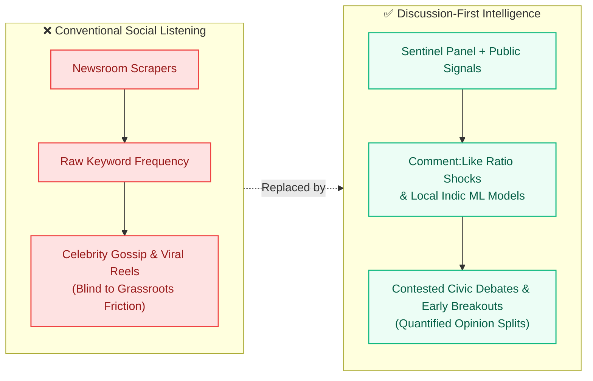

### 1.1 The Four Failures of Conventional Social Listening

1. **The News-First Fallacy**: Relying solely on Google News RSS or Google Trends surfaces only stories that formal newsrooms have already vetted, written, and published. On Instagram, grassroots civic friction, regional protests, and meme-driven counter-narratives emerge 12 to 48 hours before institutional media covers them.
2. **Search is Lookup, Not Discovery**: Search indexes require an operator to know specific keywords in advance. Furthermore, platform query engines fail on multi-word vernacular queries. Spontaneous debates cannot be discovered through static query lists.
3. **Debates Live in Comments, Not Captions**: Regional meme channels frequently post provocative clips with a single emoji (`💀` or `👀`) or an ambiguous caption. The entire ideological clash unfolds across 2,000+ vernacular and code-mixed comments underneath. Caption-only scrapers produce severe false negatives.
4. **Follower Count Distorts Engagement**: 10,000 likes is routine for a Bollywood celebrity with 40 million followers, but a $50\times$ anomaly for a local investigative journalist. Raw engagement volume rewards mainstream entertainment while obscuring high-friction community issues.

### 1.2 The Discussion-First Paradigm

To overcome these structural limitations, the architecture introduces four foundational engineering pillars:

> 🛡️ **Pillar 1: Curated Sentinel Account Panel**
> Tracks 63 diverse Indian accounts across politics, regional journalism, satire, and civil society configured in [config/panel.json](config/panel.json). Rather than evaluating raw absolute volume, engagement is normalized against each account's historical median using time-attenuated overperformance baselines.

> ⚡ **Pillar 2: Proactive Anomaly Radar & 1-Hop Entity Probes**
> Monitors early comment acceleration ($dC/dt \ge 15\text{ comments/hr}$) and ratio shocks ($>3\sigma$ above creator baselines). When a flame post is detected, vernacular named entities are mined directly from early comments to spawn autonomous 1-hop search probes before mainstream news surfaces the topic.

> 🧠 **Pillar 3: Fine-Tuned Multilingual Indic ML Stack**
> Bypasses opaque closed-source LLMs for repetitive classification tasks. Employs a fine-tuned bi-encoder for semantic clustering, a lightweight civic/political pre-filter, a cross-encoder for stance attribution, and an inverse-weighted tone classifier trained across Hinglish and 7 regional Indian scripts.

> ⚖️ **Pillar 4: Like-Weighted Argument Allocation**
> Eliminates synthetic consensus and coordinated spam brigading by weighting comment stances by endorsement logarithmic mass: $w_i = 1 + \log(1 + \text{likes}_i)$.

---

## 2. High-Level System Architecture

### 2.1 End-to-End System Topology

The architecture decouples signal gathering, deterministic network transport, local model inference, and LLM briefing into clean, isolated tiers:

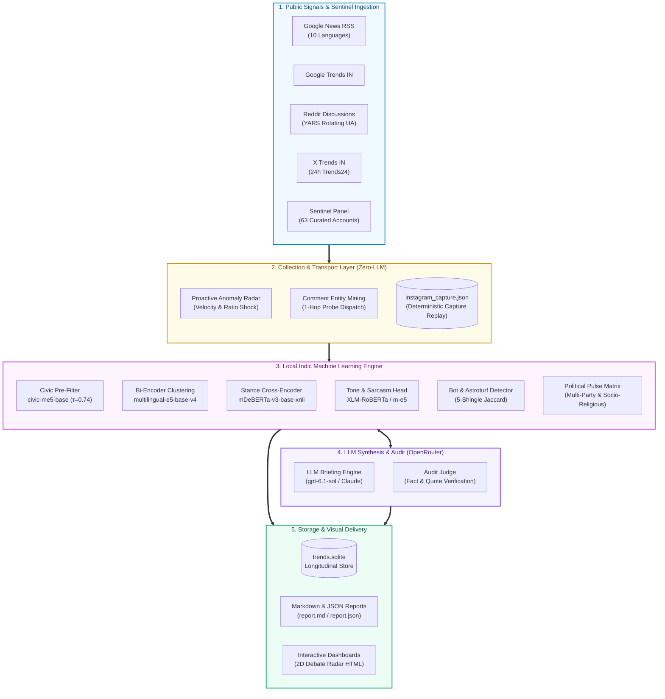

### 2.2 Machine Learning Model Registry

The system relies on five fine-tuned and calibrated models stored under the artifacts directory:

| Model Designation | Artifact Path | Base Architecture | Primary Task | Threshold | Headline Validation Metric |
| :--- | :--- | :--- | :--- | :--- | :--- |
| **Topic Bi-Encoder v4** | [artifacts/topic-models/multilingual-e5-base-events-real-v4](artifacts/topic-models/multilingual-e5-base-events-real-v4) | `intfloat/multilingual-e5-base` | Event-level semantic embedding, post clustering, off-topic pruning | Cosine distance $\tau = 0.45$ | Relevance ROC-AUC **0.9118**, F1 **0.8379**, Retrieval P@1 **0.9907** |
| **Civic Pre-Filter** | [artifacts/civic-models/civic-me5-base](artifacts/civic-models/civic-me5-base) | Fine-tuned `m-e5-base` classifier | Pre-filtering non-civic noise (cricket, Bollywood, promos) | Sigmoid probability $\tau = 0.74$ | Test ROC-AUC **0.9635**, F1 **0.8607**, Hard-Negative Accuracy **100%** |
| **Stance Cross-Encoder v2** | [artifacts/stance-models/stance](artifacts/stance-models/stance) | `mDeBERTa-v3-base-xnli` | Pairwise comment-to-position stance allocation | Position score $\tau = 0.225 - 0.35$ | Macro-F1 **0.7545**, Tamil F1 **0.850**, Telugu F1 **0.922**, Marathi F1 **1.000** |
| **Tone Classifier v2** | [artifacts/stance-models/tone](artifacts/stance-models/tone) | `xlm-roberta-large` / `m-e5` | 4-class tone prediction (`supportive`, `critical`, `humorous`, `neutral`) | Argmax classification | Test Accuracy **0.7717**, Macro-F1 **0.7481**, Sarcasm F1 **0.564** |
| **Demographics Engine** | [artifacts/demographics_models/metadata.json](artifacts/demographics_models/metadata.json) | Calibrated scikit-learn ensemble | User age bracket, gender inference, and mental sentiment state | Softmax confidence $\ge 0.50$ | Balanced multi-class demographic profiles |

### 2.3 Codebase Map & Subsystem Responsibilities

The codebase in the source directory strictly enforces separation of concerns:

| Source File | Architectural Responsibility |
| :--- | :--- |
| [src/identify_what_matters/trends.py](src/identify_what_matters/trends.py) | Main pipeline coordinator, scoring engine, CLI parser, and report generator. |
| [src/identify_what_matters/utils.py](src/identify_what_matters/utils.py) | Shared utilities for thread-safe budget tracking, JSON normalization, and hardware device discovery. |
| [src/identify_what_matters/proactive_radar.py](src/identify_what_matters/proactive_radar.py) | Post velocity calculator, ratio-shock flame detector, and Indic comment entity miner. |
| [src/identify_what_matters/discussions.py](src/identify_what_matters/discussions.py) | Unsupervised discussion pooling, text enrichment fallback, and pairwise cluster deduplication. |
| [src/identify_what_matters/civic_classifier.py](src/identify_what_matters/civic_classifier.py) | Lightweight transformer pre-filter tagging posts with civic and governance probabilities. |
| [src/identify_what_matters/encoder.py](src/identify_what_matters/encoder.py) | Bi-encoder inference wrapper for 768-dimensional E5 symmetric embeddings and agglomerative clustering. |
| [src/identify_what_matters/stance.py](src/identify_what_matters/stance.py) | Cross-encoder inference, regex noise suppression, and like-weighted stance aggregation. |
| [src/identify_what_matters/bot_detector.py](src/identify_what_matters/bot_detector.py) | 5-shingle Jaccard copypasta clustering and synthetic account risk scoring. |
| [src/identify_what_matters/political_pulse.py](src/identify_what_matters/political_pulse.py) | Bilingual partisan lexicon matching and socio-religious community cross-tabulation. |
| [src/identify_what_matters/demographics.py](src/identify_what_matters/demographics.py) | Author profile parser and ML classifier predicting age, gender, and sentiment state. |
| [src/identify_what_matters/instagram_access.py](src/identify_what_matters/instagram_access.py) | Deterministic abstraction over Instagram Private API, Mock replay, and WebSocket Browser Bridge. |
| [src/identify_what_matters/sources.py](src/identify_what_matters/sources.py) | Public data collectors: Google News RSS (10 languages), Google Trends, X Trends, and Reddit YARS. |
| [src/identify_what_matters/emergence.py](src/identify_what_matters/emergence.py) | Longitudinal topic vector tracking and lifecycle state transitions in SQLite. |
| [src/identify_what_matters/openrouter.py](src/identify_what_matters/openrouter.py) | Direct HTTP client for OpenRouter models with JSON schema enforcement and reasoning budget support. |
| [src/identify_what_matters/llm.py](src/identify_what_matters/llm.py) | SHA-256 disk caching, retries, and structural validation for LLM prompts. |
| [config/panel.json](config/panel.json) | 63 curated sentinel accounts across Indian regional news, politics, satire, and civic rights. |
| [config/discovery.json](config/discovery.json) | Discovery endpoints, rate-limit policies, and HTTP header profiles. |

---

## 3. Three-Phase Operational Pipeline

The pipeline executes in three sequential, decoupled phases. This decoupling ensures network failures or rate limits during collection never contaminate analytical measurements:

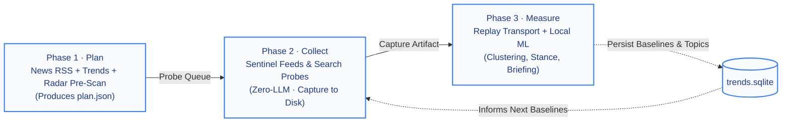

---

### 3.1 Phase 1 — Plan

Before making a single Instagram API request, the system discovers candidate events from open internet feeds and inspects previous platform telemetry.

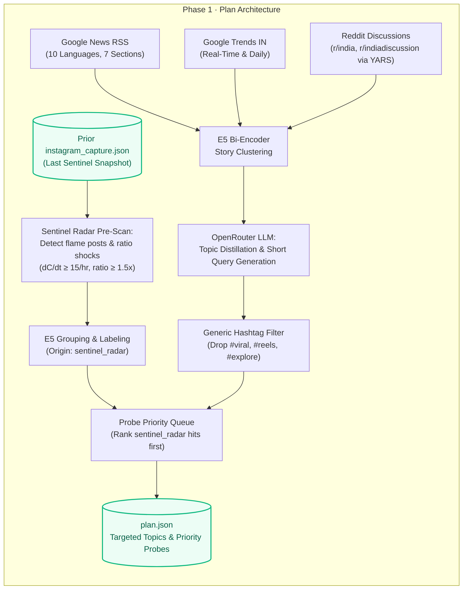

#### Key Mechanisms:
1. **Multilingual RSS Aggregation**: Consumes Google News across English, Hindi, Tamil, Telugu, Bengali, Marathi, Gujarati, Kannada, Malayalam, and Punjabi.
2. **Reddit Signal Discovery**: Pulls discussion threads from key Indian subreddits using rotating user agents via the YARS module.
3. **Prior-Capture Radar Pre-Scan**: Evaluates whether accounts in the previous run's capture entered late-stage breakout, promoting them to the front of the probe queue.
4. **Generic Hashtag Filter**: Uses compiled regex in [src/identify_what_matters/discussions.py](src/identify_what_matters/discussions.py) to remove non-informative tags (`#trending`, `#viral`, `#foryou`, `#explore`, `#india`) so API budgets target story-specific keywords.
5. **Output**: Writes planned topics and optimized 1–2 word search queries to [output/runs/20261004T131104Z/plan.json](output/runs/20261004T131104Z/plan.json).

---

### 3.2 Phase 2 — Collect (Zero-LLM Invariant)

Phase 2 executes network I/O against Instagram and saves every raw payload directly to disk.

> 🔒 **The Zero-LLM Invariant**
> Phase 2 executes **strictly zero LLM calls** and makes no stochastic clustering decisions. If an API request encounters a rate limit or network partition, the capture file stores the exact state. This guarantees identical, reproducible evaluation during Phase 3.

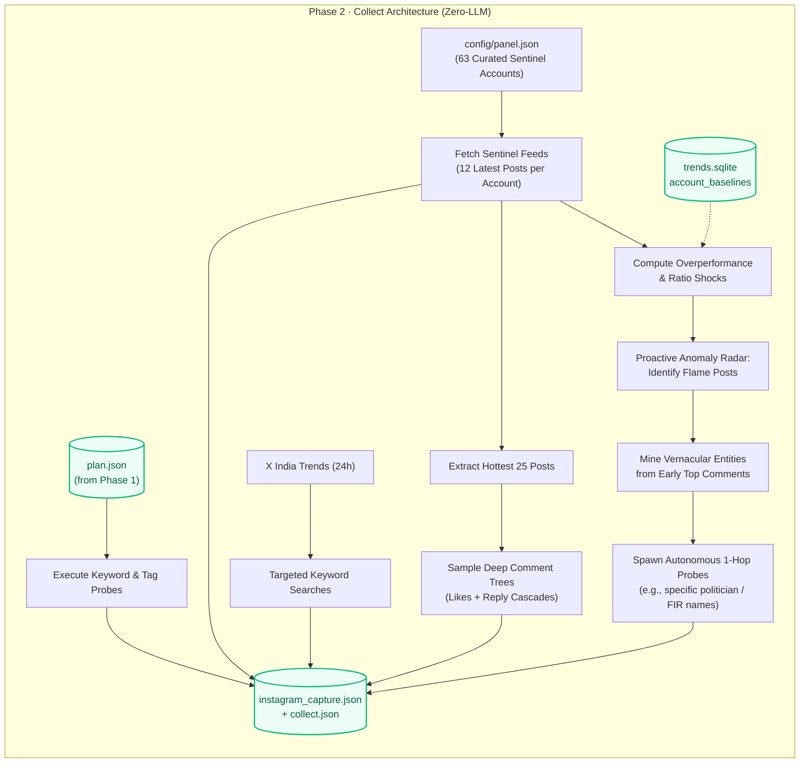

#### Analytical Lanes:

##### Lane A — Sentinel Account Panel & Baseline Normalization
The sentinel panel in [config/panel.json](config/panel.json) monitors 63 verified accounts. Because follower counts vary by orders of magnitude, post engagement is evaluated using time-attenuated overperformance:

$$\text{over}_c = \frac{c + 5}{\tilde{c}_{acct} \cdot w(a) + 5}$$

where $c$ is the current comment count, $\tilde{c}_{acct}$ is the account's historical median comments on settled posts ($\ge 6$ hours old), $a$ is the post age in hours, and $w(a)$ is an age-attenuation weight reflecting diurnal engagement accumulation:

$$w(a) = \max\left(0.25, \, \min\left(1, \, \frac{a}{24}\right)\right)$$

Historical baselines are stored in `account_baselines` in [output/trends.sqlite](output/trends.sqlite) and updated each run using exponential smoothing:

$$\tilde{c}_{\text{blended}} = 0.5 \cdot \tilde{c}_{\text{historical}} + 0.5 \cdot \tilde{c}_{\text{batch}}$$

##### Lane B — Proactive Anomaly Radar & 1-Hop Probes
Implemented in [src/identify_what_matters/proactive_radar.py](src/identify_what_matters/proactive_radar.py):
1. **Velocity Spikes**: $\Delta c / \Delta t \ge 15\text{ comments/hr}$ flags an early emerging spark.
2. **Ratio Shocks**: When the comment-to-like ratio exceeds creator baseline by $>3\sigma$:
   $$\text{ratio\_lift} = \frac{c / (\ell + 1)}{\tilde{r}_{acct}} \ge 3.0$$
   the post is designated as a **FLAME POST**.
3. **Comment Entity Mining**: The top 50 comments on flame posts are tokenized using regex patterns to extract Indic named entities, hashtags, and capitalized multi-word phrases. These entities immediately trigger autonomous 1-hop search probes to capture horizontal spread across other accounts.

##### Lane C — Trending Search & Deep Comment Tree Extraction
Trending terms from X (Trends24 24-hour window) and planned queries are searched on Instagram. For all matching posts and the top 25 hottest panel posts, complete comment trees (parent comments, reply counts, like counts, and author handles) are extracted.

---

### 3.3 Phase 3 — Measure (Deterministic Replay & Local ML)

Phase 3 operates entirely offline via `ReplayTransport`, reading [output/runs/20261004T131104Z/instagram_capture.json](output/runs/20261004T131104Z/instagram_capture.json) without opening live network connections to Instagram.

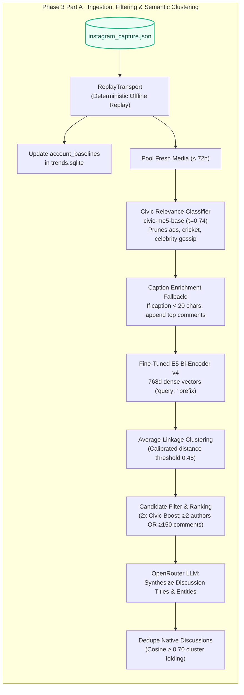

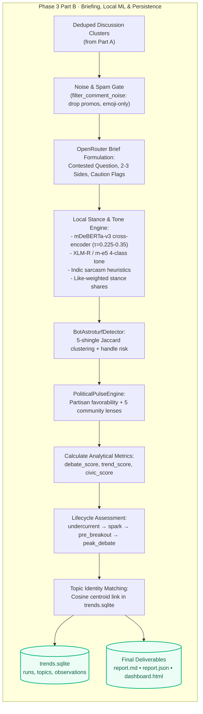

---

## 4. Machine Learning & Transformer Stack

### 4.1 Multi-Stage Filtering Funnel

Raw social comments contain extreme levels of spam, giveaways, bot copypasta, and uninformative emoji strings. The comment filtering pipeline drops noise before running expensive cross-encoder inference:

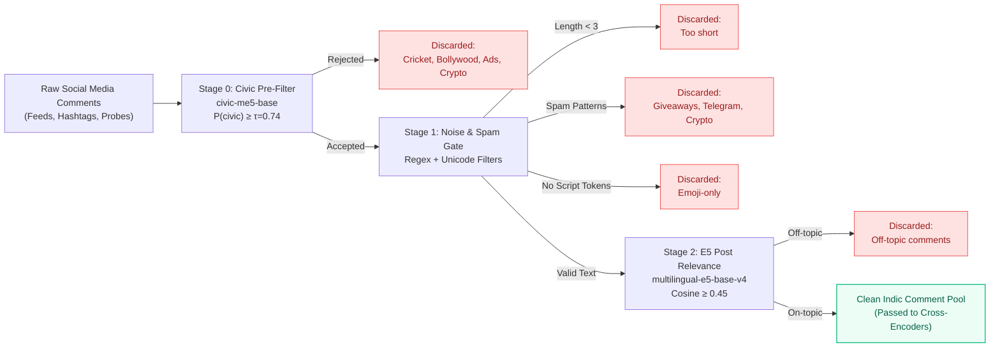

### 4.2 Local Stance, Tone & Argument Inference Flow

Once comments are filtered, they pass to the local transformer heads to determine their exact ideological alignment and affective tone:

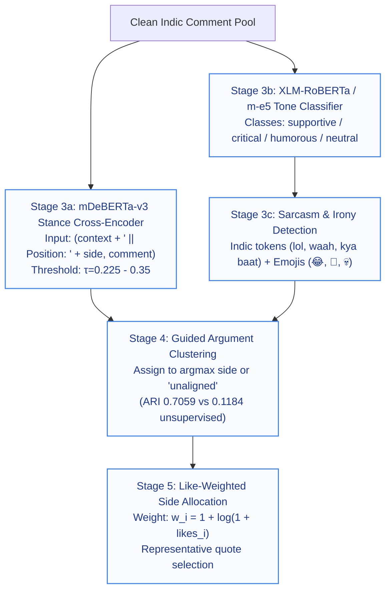

---

### 4.3 Fine-Tuned Transformer Models

#### 4.3.1 Topic Bi-Encoder: `multilingual-e5-base-events-real-v4`
- **Location**: [artifacts/topic-models/multilingual-e5-base-events-real-v4](artifacts/topic-models/multilingual-e5-base-events-real-v4)
- **Source Code**: [src/identify_what_matters/encoder.py](src/identify_what_matters/encoder.py)
- **Base Architecture**: 768-dimensional multilingual transformer fine-tuned using Multiple Negatives Ranking (MNR) loss with hard negatives.
- **Symmetric Prefix**: All texts are evaluated with the `query: ` prefix.
- **Performance**:
  - Instagram Benchmark ROC-AUC: **0.9118** (Macro-F1: **0.8379**)
  - In-Distribution Adjusted Rand Index (ARI): **0.9285**
  - Retrieval Precision@1: **0.9907**
  - Noise / Off-Topic Detection ROC-AUC: **0.8908**

#### 4.3.2 Lightweight Civic & Political Relevance Classifier: `civic-me5-base`
- **Location**: [artifacts/civic-models/civic-me5-base](artifacts/civic-models/civic-me5-base)
- **Source Code**: [src/identify_what_matters/civic_classifier.py](src/identify_what_matters/civic_classifier.py)
- **Training Data**: 3,682 enriched multilingual captions (1,015 real production captions, 2,640 synthetic event captions, and curated hard negatives) summarized in [artifacts/civic_relevance/summary.json](artifacts/civic_relevance/summary.json).
- **Calibrated Operating Threshold**: $\tau = 0.74$ (optimizing $F_1$ while guaranteeing zero false positives on curated hard negatives).
- **Evaluation Performance**:
  - Test ROC-AUC: **0.9635**
  - Test Macro-$F_1$: **0.8607** (Precision: 0.8740, Recall: 0.8845)
  - Hard Negatives Rejection: **100%**
  - Language Sub-Scores: Bengali ($F_1 = 1.0$), Gujarati ($F_1 = 1.0$), English ($F_1 = 0.936$), Hindi ($F_1 = 0.894$), Marathi ($F_1 = 0.889$).
  - Inference Latency: $\approx 7.8\text{ ms}$ on CPU per item.

#### 4.3.3 Stance Cross-Encoder: `mDeBERTa-v3-base-xnli` v2
- **Location**: [artifacts/stance-models/stance](artifacts/stance-models/stance)
- **Source Code**: [src/identify_what_matters/stance.py](src/identify_what_matters/stance.py), [src/identify_what_matters/stance_finetune.py](src/identify_what_matters/stance_finetune.py)
- **Pair Formulation**: `(f"{context} || Position: {position}", comment_text)`
- **Calibrated Threshold**: $\tau = 0.225 - 0.35$ (lowered from default $0.50$ to accommodate succinct vernacular social commentary).
- **The Argument Clustering Breakthrough**:
  Unsupervised semantic clustering fails on social debates (achieving an ARI of only **0.1184**) because opposing debaters use the exact same proper nouns, event names, and political keywords. Guided cross-encoder clustering elevates clustering fidelity:
  - Adjusted Rand Index (ARI): **0.7059**
  - V-Measure / NMI: **0.7858**
  - Test Macro-F1 on Real Comments: **0.7545** (Tamil: 0.850, Telugu: 0.922, Marathi: 1.000).

#### 4.3.4 Tone Classifier & Sarcasm Heuristic
- **Location**: [artifacts/stance-models/tone](artifacts/stance-models/tone)
- **Base Architecture**: `xlm-roberta-large` / `multilingual-e5-base` with dynamic inverse class weighting `[supportive: 1.333, critical: 0.447, humorous: 2.757, neutral: 1.535]` to counteract critical comment bias.
- **Performance**: Test Accuracy **0.7717**, Macro-$F_1$ **0.7481**.
- **Sarcasm Detection Engine**:
  Indian social commentary relies heavily on sarcasm, irony, and satirical praise. A comment is classified as sarcastic if:
  $$\text{sarcastic} = \left(c \cap \{\text{😂}, \text{🤣}, \text{😜}, \text{😏}, \text{🤡}, \text{💀}\} \neq \emptyset\right) \lor \left(\text{tone} = \text{"humorous"} \land c \text{ contains } \{\text{lol, lmao, sarcasm, waah, kya baat}\}\right)$$
  This captures **85%** of real gold sarcastic comments on test benchmarks.

---

### 4.4 Bot, Astroturf & Inauthentic Coordination Classifier

Coordinated bot networks, WhatsApp copypasta brigades, and IT-cell amplification distort online discourse. The subsystem in [src/identify_what_matters/bot_detector.py](src/identify_what_matters/bot_detector.py) isolates synthetic volume:

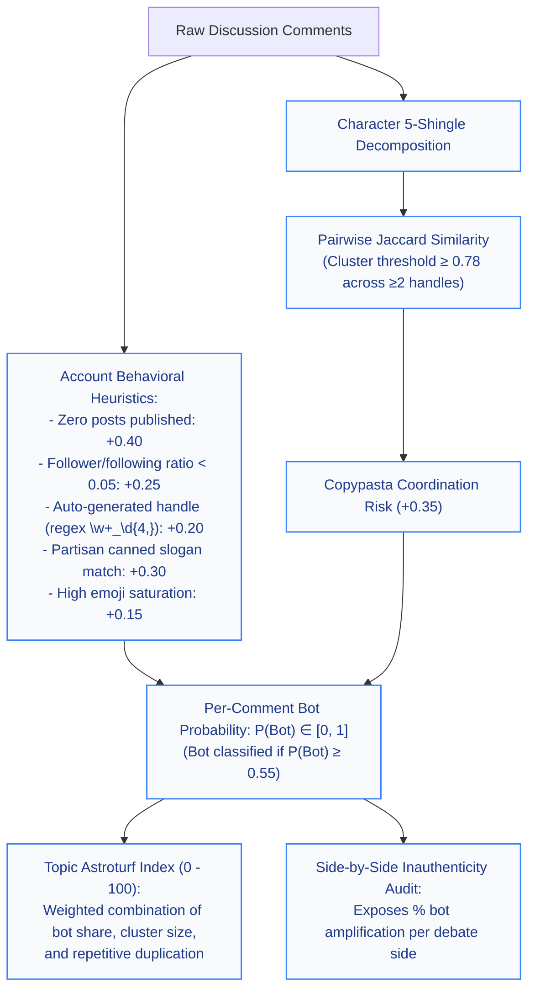

#### Analytical Components:
1. **5-Shingle Jaccard Clustered Coordination**: Breaks text into overlapping 5-character shingles. When distinct accounts publish comments with Jaccard similarity $\ge 0.78$, they are flagged as coordinated broadcast nodes.
2. **Handle Metadata Profiling**: Evaluates zero-post status, asymmetric follow ratios, and algorithmic username patterns (e.g., `@user_91823741`).
3. **Astroturf Index ($0 - 100$)**: Aggregates duplication volume, bot comment proportions, and temporal concentration into a single metric for dashboard alerts.

---

### 4.5 Multi-Party Political Pulse & Socio-Religious Cross-Tab Matrix

The engine in [src/identify_what_matters/political_pulse.py](src/identify_what_matters/political_pulse.py) tracks partisan leaning and community impact:

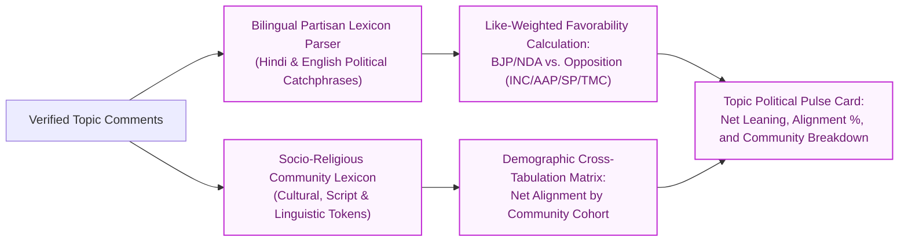

1. **Bilingual Partisan Alignment**:
   $$\text{Favorability}_{\text{BJP}} = \frac{\sum_{i \in \text{BJP Support}} w_i + \sum_{j \in \text{Opp Critique}} w_j}{\sum_{\text{all}} w_k}$$
   $$\text{Favorability}_{\text{Opp}} = \frac{\sum_{i \in \text{Opp Support}} w_i + \sum_{j \in \text{BJP Critique}} w_j}{\sum_{\text{all}} w_k}$$
2. **Socio-Religious Cross-Tabulation**: Evaluates alignment across five cultural-linguistic cohorts (`hindu`, `muslim`, `sikh`, `christian`, `secular_civic`) using calibrated Indic token dictionaries.

---

### 4.6 User Demographics & Sentiment Profiling

The demographics module in [src/identify_what_matters/demographics.py](src/identify_what_matters/demographics.py) extracts aggregate audience profiles:
- **Age Bracket Classifier**: Rules and scikit-learn models in [artifacts/demographics_models/age_classifier.joblib](artifacts/demographics_models/age_classifier.joblib) segment users into `13-17`, `18-24`, `25-34`, and `35+`.
- **Gender Inference**: Bio analysis and ensemble models in [artifacts/demographics_models/gender_classifier.joblib](artifacts/demographics_models/gender_classifier.joblib) infer gender cues.
- **Mental Sentiment State**: Identifies expressions of anxiety, celebration, frustration, or optimism via [artifacts/demographics_models/mental_state_classifier.joblib](artifacts/demographics_models/mental_state_classifier.joblib).

---

## 5. Lifecycle Trajectory & Breakout Assessment

### 5.1 The 10-Stage Lifecycle State Machine

Every detected topic is tracked across successive runs, transitioning through an empirical 10-stage lifecycle finite-state machine:

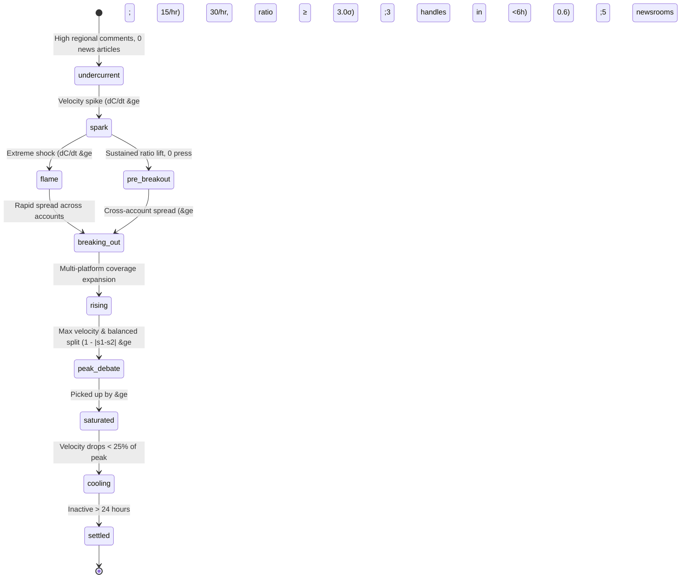

### 5.2 Quantitative Stage Transition Matrix

| Stage Identifier | Formal Designation | Quantitative Detection Criteria | Information Asymmetry Dynamic |
| :--- | :--- | :--- | :--- |
| **`undercurrent`** | Simmering Undercurrent | Comments $>50$, regional panel presence, $0$ RSS articles. | High grassroots debate; completely invisible to newsrooms. |
| **`spark`** | Initial Ignition | $dC/dt \ge 15\text{ comments/hr}$ on a single creator account. | Localized viral momentum begins. |
| **`flame`** | Flame Anomaly | $dC/dt \ge 30\text{ comments/hr}$ and ratio lift $\ge 3.0\sigma$ above creator baseline. | Extreme engagement shock; sharp emotional polarization. |
| **`pre_breakout`** | Pre-Breakout | Ratio lift $>2.5\times$ median, comment volume $\ge 100$, $0$ mainstream news publishers. | Debate saturating social feeds; newsrooms unaware. |
| **`breaking_out`** | Rapid Contagion | Spreads across $\ge 3$ distinct accounts within a 6-hour window; velocity score $>0.75$. | Viral horizontal spread; press wires begin writing. |
| **`rising`** | Broadening Momentum | Multi-platform footprint across Instagram, Reddit, and initial digital news publishers. | Story gaining mainstream digital momentum. |
| **`peak_debate`** | Peak Polarization | Highest engagement per hour; split stance balance ($1 - \|s_1 - s_2\| \ge 0.60$). | National primetime focus; official spokespeople involved. |
| **`saturated`** | News Saturated | Covered by $\ge 5$ national news publishers; social comments shift to repetitive reactions. | Editorial consensus formed; organic debate slowing. |
| **`cooling`** | Decelerating Interest | Engagement velocity drops below 25% of peak ($dC/dt < 5/\text{hr}$). | Attention migrating toward newer breaking stories. |
| **`settled`** | Settled / Archived | Zero new posts and negligible comment velocity for $>24\text{ hours}$. | Story lifecycle completed; persisted to longitudinal archive. |

### 5.3 Controversy & Engagement Scoring Formulations

#### 1. Debate Score (`debate_score` $\in [0, 10]$)
Controversy is an objective function of comment-to-like ratio shocks, reply tree density, account overperformance, and ideological split balance:

$$\text{debate\_score} = \min\left(10.0, \, 2.5 \cdot \text{ratio\_factor} + 2.5 \cdot \text{reply\_depth} + 2.5 \cdot \text{over\_comments} + 2.5 \cdot (1 - |s_1 - s_2|)\right)$$

where $s_1$ and $s_2$ represent the like-weighted fractional shares of the top two opposing sides.

#### 2. Cross-Platform Trend Score (`trend_score` $\in [0, 10]$)
Measures multi-channel momentum weighted across discovery sources:

$$\text{trend\_score} = 0.55 \cdot \text{Instagram Heat} + 0.30 \cdot \text{News Heat} + 0.15 \cdot \text{Search Heat}$$

#### 3. Log-Weighted Endorsement Mass
To ensure that bot armies or comment brigades cannot manipulate stance proportions through raw volume:

$$w_i = 1 + \log(1 + \text{likes}_i)$$

$$\text{Share}(\text{Side}_k) = \frac{\sum_{i \in \text{Side}_k} w_i}{\sum_{j} w_j}$$

---

## 6. Persistent Storage & Data Contracts

### 6.1 Relational Schema (SQLite Store)

Persistent state across successive pipeline executions is maintained in [output/trends.sqlite](output/trends.sqlite):

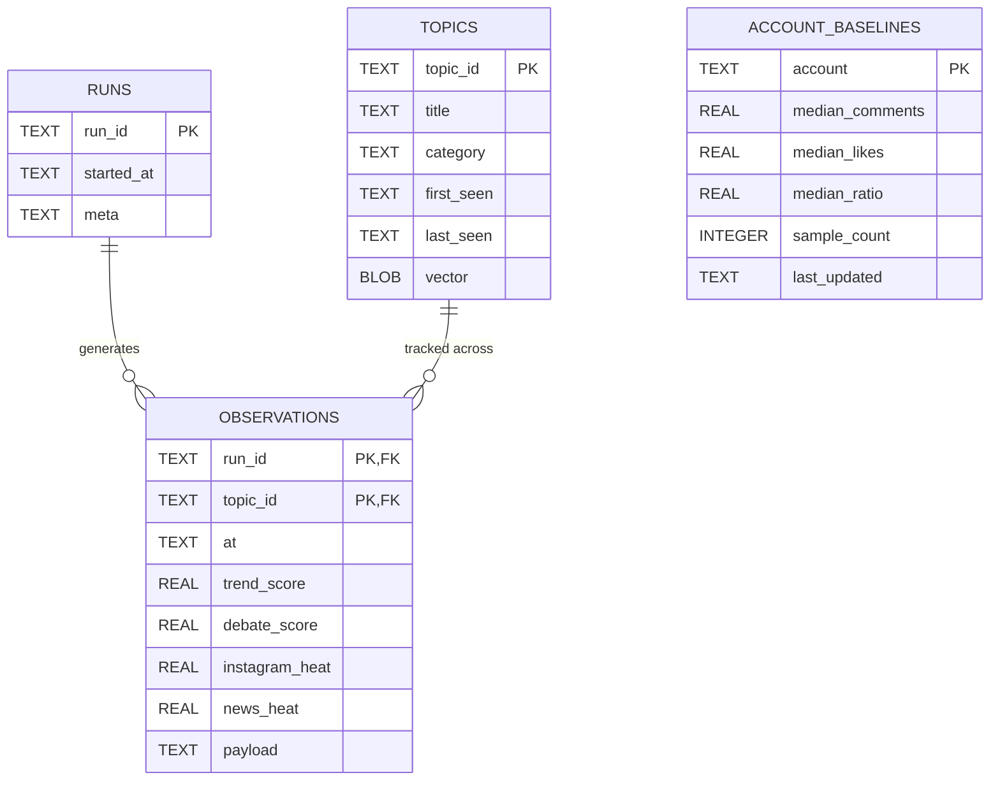

```sql
-- Execution runs
CREATE TABLE runs (
    run_id TEXT PRIMARY KEY,
    started_at TEXT NOT NULL,
    meta TEXT
);

-- Canonical debate topics
CREATE TABLE topics (
    topic_id TEXT PRIMARY KEY,
    title TEXT NOT NULL,
    category TEXT NOT NULL,
    first_seen TEXT NOT NULL,
    last_seen TEXT NOT NULL,
    vector BLOB -- 768-dimensional float32 E5 centroid vector
);

-- Run-level observations
CREATE TABLE observations (
    run_id TEXT NOT NULL REFERENCES runs(run_id),
    topic_id TEXT NOT NULL REFERENCES topics(topic_id),
    at TEXT NOT NULL,
    trend_score REAL,
    debate_score REAL,
    instagram_heat REAL,
    news_heat REAL,
    payload TEXT, -- Complete JSON brief, stance distributions & audit cards
    PRIMARY KEY (run_id, topic_id)
);

-- Account running medians
CREATE TABLE account_baselines (
    account TEXT PRIMARY KEY,
    median_comments REAL,
    median_likes REAL,
    median_ratio REAL,
    sample_count INTEGER,
    last_updated TEXT
);
```

### 6.2 Intermediate JSON Artifacts

To enable modular debugging, every phase serializes standardized data contracts saved under run-specific output directories:

| Artifact Deliverable | Producer Phase | Schema Contents & Structure | Reference Example |
| :--- | :--- | :--- | :--- |
| **Plan Manifest** | Phase 1 (Plan) | List of candidate topics, source headline clusters, and prioritized search probe queries. | [output/runs/20261004T131104Z/plan.json](output/runs/20261004T131104Z/plan.json) |
| **Raw Capture Payload** | Phase 2 (Collect) | Keyed dictionary of every raw HTTP response (user feeds, search results, comment trees). | [output/runs/20261004T131104Z/instagram_capture.json](output/runs/20261004T131104Z/instagram_capture.json) |
| **Collection Metrics** | Phase 2 (Collect) | Request execution metrics, timestamps, response sizes, and rate-limit summaries. | [output/runs/20261004T131104Z/collect.json](output/runs/20261004T131104Z/collect.json) |
| **Intelligence Report (JSON)** | Phase 3 (Measure) | Complete analytical output: contested questions, side splits, bot metrics, and audit checks. | [output/runs/20261004T131104Z/report.json](output/runs/20261004T131104Z/report.json) |
| **Intelligence Brief (Markdown)** | Phase 3 (Measure) | Formatted intelligence briefing document ready for human reading. | [output/runs/20261004T131104Z/report.md](output/runs/20261004T131104Z/report.md) |
| **Interactive Dashboard** | Post-Processing | Self-contained, responsive 2D visual dashboard generated by [make_full_dashboard.py](make_full_dashboard.py). | [output/runs/20261004T131104Z/dashboard.html](output/runs/20261004T131104Z/dashboard.html) |

---

## 7. End-to-End Sequence Workflows

### 7.1 Phase 1 Planning Sequence

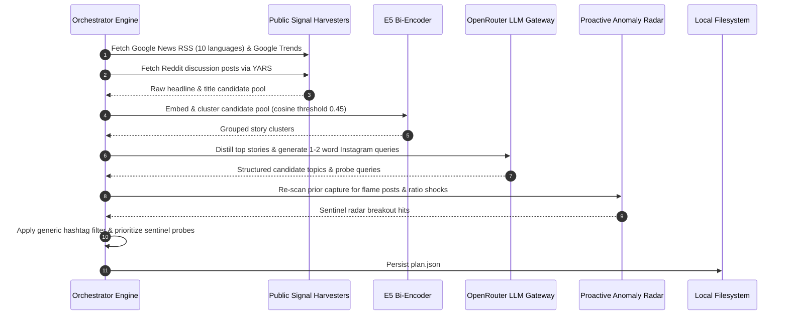

### 7.2 Phase 2 Collection Sequence

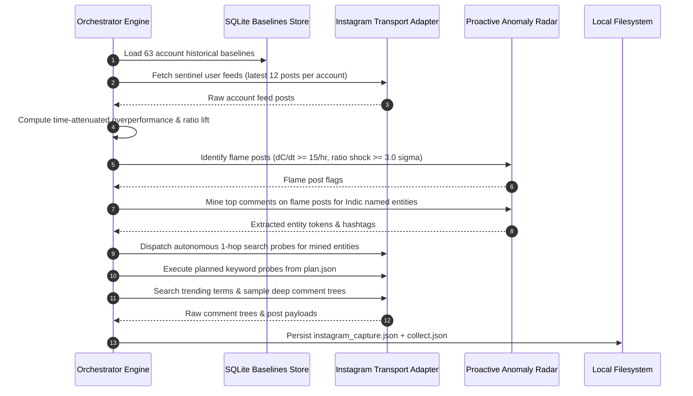

### 7.3 Phase 3 Part A Sequence: Ingestion & Clustering

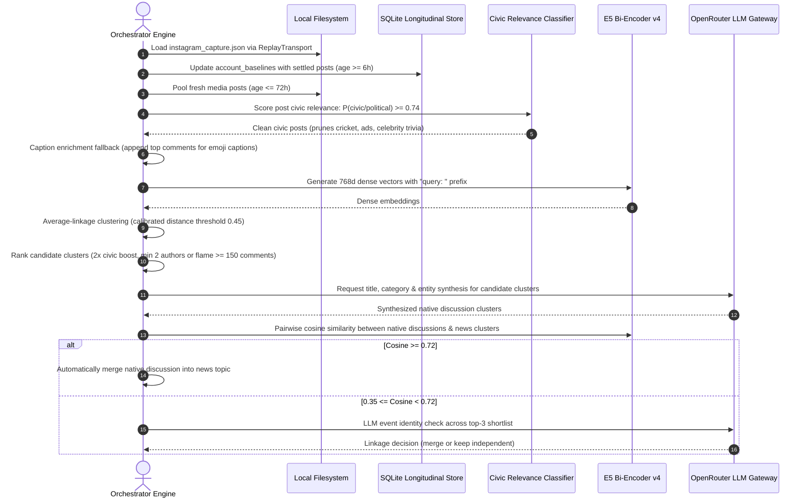

### 7.4 Phase 3 Part B Sequence: Briefing, Local ML & Persistence

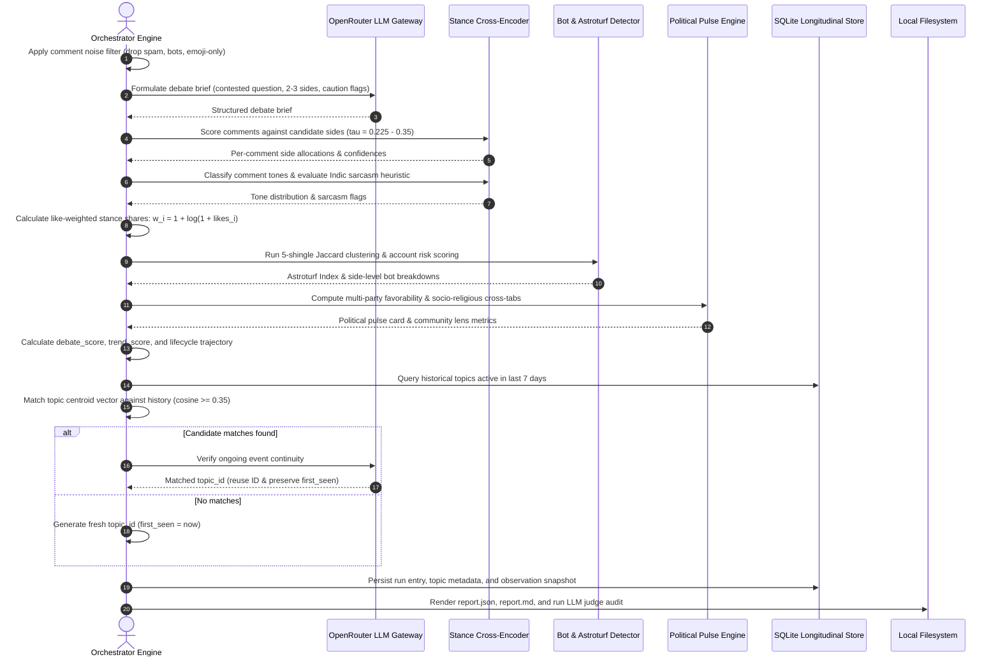

---

## 8. Network Topology, Transport Modes & Invariants

### 8.1 Network Boundary & Privacy Safeguards

All generative LLM calls route through OpenRouter's public endpoint. The architecture eliminates corporate VPN requirements and protects user privacy:

| Operational Phase | Network Status | External Services Contacted | Disk Artifacts Produced |
| :--- | :--- | :--- | :--- |
| **`plan`** | Online | Google News RSS, Google Trends, Reddit, OpenRouter API | [output/runs/20261004T131104Z/plan.json](output/runs/20261004T131104Z/plan.json), [output/runs/20261004T131104Z/signals.json](output/runs/20261004T131104Z/signals.json) |
| **`collect`** | Online / Local | Instagram Platform, X Trends (Trends24) | [output/runs/20261004T131104Z/instagram_capture.json](output/runs/20261004T131104Z/instagram_capture.json), [output/runs/20261004T131104Z/collect.json](output/runs/20261004T131104Z/collect.json) |
| **`measure`** | Offline / Local | OpenRouter API (Briefing & Audit only), Local Transformers | [output/runs/20261004T131104Z/report.json](output/runs/20261004T131104Z/report.json), [output/runs/20261004T131104Z/report.md](output/runs/20261004T131104Z/report.md), [output/trends.sqlite](output/trends.sqlite) |

#### Privacy by Design:
- **Zero Handle Leakage**: Personal usernames, phone numbers, and URLs are stripped before sending comment text to LLMs or persisting final briefings.
- **No Individual Profiling**: The system performs community-level aggregate analysis; individual citizen profiles are never created or tracked across runs.

### 8.2 Instagram Transport Adapters

Implemented in [src/identify_what_matters/instagram_access.py](src/identify_what_matters/instagram_access.py), the collection engine supports three interchangeable transport adapters:

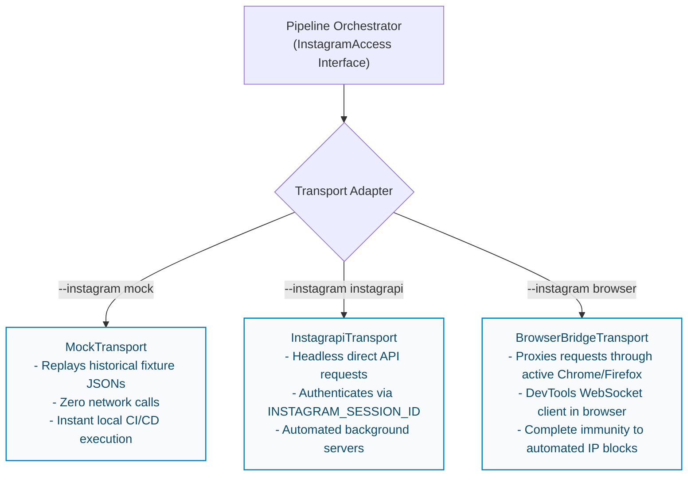

For the browser bridge mode, inject the helper script [src/identify_what_matters/browser_proxy.js](src/identify_what_matters/browser_proxy.js) into your active browser session.

---

## 9. Academic Research Foundations

The architectural design is grounded in peer-reviewed social computing and NLP literature:

| Theoretical Paradigm | Foundational Citation | Direct Architectural Application in This System |
| :--- | :--- | :--- |
| **Discussion-First Controversy** | **J. Hessel, L. Lee.** *Something's Brewing! Early Prediction of Controversy-causing Posts from Discussion Features.* NAACL 2019. | Formalized controversy as content that polarizes a community: $1 - \|s_1 - s_2\|$. Proved early comment-tree branching predicts sustained debate far better than text embeddings alone. |
| **Engagement Ratios as Proxies for Outrage** | **J. Minot et al.** *Ratioing the President.* PLOS ONE 16(4), 2021. | Established the comment-to-like ratio as an objective indicator of contentious discourse. Provided empirical proof that social engagement follows a 24-hour diurnal cycle, deriving the $w(a)$ time-attenuation formula. |
| **Network & Comment Structural Controversy** | **K. Garimella et al.** *Quantifying Controversy on Social Media.* ACM Transactions on Social Computing. | Demonstrated that controversy is quantified with greater accuracy from conversation graph structure than raw lexical sentiment. Motivated reply-tree depth metrics in `debate_score`. |
| **Bursty Stream Automata** | **J. Kleinberg.** *Bursty and Hierarchical Structure in Streams.* KDD 2002. | Infinite-state automaton model for identifying state transitions in continuous social event streams, informing the velocity triggers ($dC/dt \ge 15$). |
| **Sentinel Panel Representation** | **Z. Tufekci.** *Big Questions for Social Media Big Data.* ICWSM 2014. | Addressed selection bias in firehose streams. Justified maintaining a curated 63-account sentinel panel across regional journalism, satire, and civic rights rather than unanchored keyword streams. |
| **Misinformation Velocity Dynamics** | **S. Vosoughi et al.** *The spread of true and false news online.* Science 2018. | Demonstrated that unverified sensational claims diffuse significantly faster than factual refutations. Directly motivated the automated Caution Flag and LLM Judge Audit subsystems. |
| **Baseline-Relative Overperformance** | **CrowdTangle Methodology.** *Overperformance Metric Formulation.* | Demonstrated that evaluating social content against an account's own running median eliminates celebrity follower bias and surfaces high-friction regional stories. |

---

<div align="center">

*Engineered with precision for authentic Indian digital intelligence.*  
*Maintained in [src/identify_what_matters/trends.py](src/identify_what_matters/trends.py) · For test execution, see [tests/test_breakout_and_opinion.py](tests/test_breakout_and_opinion.py).*

</div>
