# Architecture: Finding What India is Discussing and Debating on Instagram

*Comprehensive Architecture, System Design, and Model Flow Document*  
*As of October 2026. For environment setup and CLI commands, see [README.md](README.md). For model evaluation metrics and training history, see [docs/TRAINING_RESULTS.md](docs/TRAINING_RESULTS.md).*

## Contents

1. [Why This Exists](#1-why-this-exists)
2. [System at a Glance](#2-system-at-a-glance)
3. [Pipeline Phases](#3-pipeline-phases)
   - [3.1 Phase 1 — Plan](#31-phase-1--plan)
   - [3.2 Phase 2 — Collect](#32-phase-2--collect-no-llm)
   - [3.3 Phase 3 — Measure](#33-phase-3--measure)
4. [Machine Learning & Transformer Stack](#4-machine-learning--transformer-stack)
   - [4.4 Bot, Astroturf & Inauthentic Coordination Classifier](#44-bot-astroturf--inauthentic-coordination-classifier)
   - [4.5 Political Favorability Pulse & Socio-Religious Lens Engine](#45-political-favorability-pulse--socio-religious-lens-engine)
5. [Lifecycle Trajectory & Breakout Assessment](#5-lifecycle-trajectory--breakout-assessment)
6. [Storage Schema](#6-storage-schema-outputtrendssqlite)
7. [End-to-End Data Flow (Sequence Diagrams)](#7-end-to-end-data-flow-sequence-diagrams)
8. [Network & Operational Topology](#8-network--operational-topology)
9. [Research Basis](#9-research-basis)

---

## 1. Why This Exists

Understanding public discourse in India requires tracking what citizens, meme creators, and regional commentators are actively reacting to on social platforms. Early automated social-listening pipelines suffered from an inherent **news-first bias**:

1. **The News-First Fallacy**: Relying solely on Google News RSS and Google Trends means discovering only stories that professional newsrooms have already covered. On Instagram, grass-roots debates, viral audio memes, and regional political controversies emerge hours or days before national media publishes an article.
2. **Search is Lookup, Not Discovery**: Search engines and platform APIs only return posts when an operator already knows the exact keywords to query. Furthermore, queries longer than 2–3 words fail on Instagram's search index.
3. **Debates Live in Comments, Not Captions**: An Indian meme account might post a short provocative video with a caption containing only an emoji (`💀`) or a generic tag. The entire political debate unfolds across 2,000+ vernacular comments underneath. Evaluating captions alone produces false negatives.
4. **Account Size Distorts Engagement**: 10,000 likes is routine for a celebrity handle with 20 million followers, but a massive anomaly for a regional investigative journalist. Measuring raw counts favours mega-accounts while obscuring breakout debates.

To solve this, the architecture implements a **discussion-first, multi-lane discovery system** powered by local fine-tuned transformers:

- **Account Sentinel Panel**: Tracks 63 curated accounts across regional news, satire, civic issues, and political commentary. Calculates per-account running engagement baselines (CrowdTangle-style overperformance).
- **Proactive Anomaly Radar**: Detects flame posts ($dC/dt \ge 15\text{ comments/hr}$, $+3\sigma$ ratio shock), extracts vernacular named entities from early comments, and executes autonomous 1-hop search probes before stories hit national news.
- **Local Fine-Tuned Transformer Stack**: a bi-encoder for clustering/relevance, a lightweight civic/political pre-filter, a stance cross-encoder, and a tone classifier — see the [quick reference table](#model-quick-reference) below.
- **Like-Weighted Argument Clustering**: Rather than relying on the LLM's high-level subjective impression, comment stance shares and top representative quotes are calculated directly from verified comment-level predictions weighted by $1 + \log(1 + \text{likes})$.

---

## 2. System at a Glance

At the highest level, the pipeline runs in three sequential phases and persists state so later runs can detect what changed:

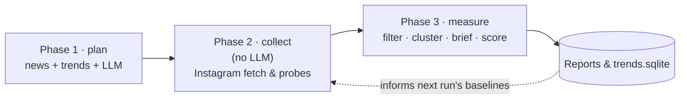

Each phase is detailed in [Section 3](#3-pipeline-phases) with its own diagram and narrative, and the full step-by-step sequence for each phase is in [Section 7](#7-end-to-end-data-flow-sequence-diagrams).

### Model Quick Reference

| Model | Location | Role | Threshold | Headline Metric |
| :--- | :--- | :--- | :--- | :--- |
| Bi-Encoder — `multilingual-e5-base-events-real` | [artifacts/topic-models/multilingual-e5-base-events-real](artifacts/topic-models/multilingual-e5-base-events-real) | Caption clustering, post-relevance filter, comment-noise suppression | cosine $\ge 0.45$ | Relevance AUC **0.9054**, Noise AUC **0.8908** |
| Civic/Political Relevance Classifier — `civic-me5-base` | [artifacts/civic-models/civic-me5-base](artifacts/civic-models/civic-me5-base) | Pre-filters raw posts to genuine civic/political discourse before clustering | $\tau = 0.74$ | AUC **0.9623**, F1 **0.8792** |
| Stance Cross-Encoder — fine-tuned `mDeBERTa-v3-base-xnli` | [artifacts/stance-models/stance](artifacts/stance-models/stance) | Guided argument clustering & per-comment stance allocation | $\tau = 0.35$ | Macro-F1 **0.7545** |
| Tone Classifier — fine-tuned `multilingual-e5-base` | [artifacts/stance-models/tone](artifacts/stance-models/tone) | 4-class tone (`supportive`/`critical`/`humorous`/`neutral`) feeding the sarcasm heuristic | argmax | See [docs/TRAINING_RESULTS.md](docs/TRAINING_RESULTS.md) |
| Bot & Astroturf Classifier — `BotAstroturfDetector` | [src/identify_what_matters/bot_detector.py](src/identify_what_matters/bot_detector.py) | 5-shingle Jaccard clustering + zero-post handle scoring + campaign astroturf index | Jaccard $\ge 0.78$, Score $\ge 0.55$ | Synthetic detection, astroturf index (0-100) |
| Political Pulse & Cross-Tab Engine — `PoliticalPulseEngine` | [src/identify_what_matters/political_pulse.py](src/identify_what_matters/political_pulse.py) | Partisan favorability (BJP/NDA vs. Opposition) & socio-religious community cross-tab | Log-weighted alignment | Multi-party net favorability, 5 community lenses |

### Key Modules & Files

| File | Role |
| :--- | :--- |
| [src/identify_what_matters/main.py](src/identify_what_matters/main.py) | End-to-end pipeline entrypoint (instagrapi collection → longitudinal store → emergence report) |
| [src/identify_what_matters/trends.py](src/identify_what_matters/trends.py) | Core trend pipeline: what India is discussing/debating, measured on Instagram |
| [src/identify_what_matters/trend_engine.py](src/identify_what_matters/trend_engine.py) | Orchestration engine tying the plan/collect/measure phases together |
| [src/identify_what_matters/bot_detector.py](src/identify_what_matters/bot_detector.py) | Bot, Astroturf & Inauthentic Coordination Classifier (comment clustering + handle risk) |
| [src/identify_what_matters/political_pulse.py](src/identify_what_matters/political_pulse.py) | Multi-Party Political Pulse & Socio-Religious Cross-tab Matrix Engine |
| [src/identify_what_matters/discussions.py](src/identify_what_matters/discussions.py) | Discussion-first discovery of Instagram debates, independent of news keywords |
| [src/identify_what_matters/proactive_radar.py](src/identify_what_matters/proactive_radar.py) | Flame-post detection & comment entity mining |
| [src/identify_what_matters/emergence.py](src/identify_what_matters/emergence.py) | Longitudinal store & emergence/lifecycle detection for topics |
| [src/identify_what_matters/encoder.py](src/identify_what_matters/encoder.py) | Shared access to the fine-tuned multilingual E5 event encoder |
| [src/identify_what_matters/civic_classifier.py](src/identify_what_matters/civic_classifier.py) | Civic/political classifier training, calibration & inference |
| [src/identify_what_matters/stance.py](src/identify_what_matters/stance.py) | Local stance/tone cross-encoder inference + noise filters |
| [src/identify_what_matters/stance_finetune.py](src/identify_what_matters/stance_finetune.py) | Stance/tone cross-encoder fine-tuning on the GPU VM |
| [src/identify_what_matters/instagram_access.py](src/identify_what_matters/instagram_access.py) | Instagram account feeds, keyword search, hashtags, comments |
| [src/identify_what_matters/sources.py](src/identify_what_matters/sources.py) | Public India signals: Google Trends, Google News, X trends, Reddit |
| [config/panel.json](config/panel.json) | 63 curated sentinel accounts (politics, satire, news, civic) |
| [config/discovery.json](config/discovery.json) | Discovery scope, panel policy & request budget limits |

---

## 3. Pipeline Phases

### 3.1 Phase 1 — Plan

Plans what to look for before touching Instagram: clusters today's news/search signals into candidate stories, and separately re-scans the *previous* run's Instagram capture for anything already on fire.

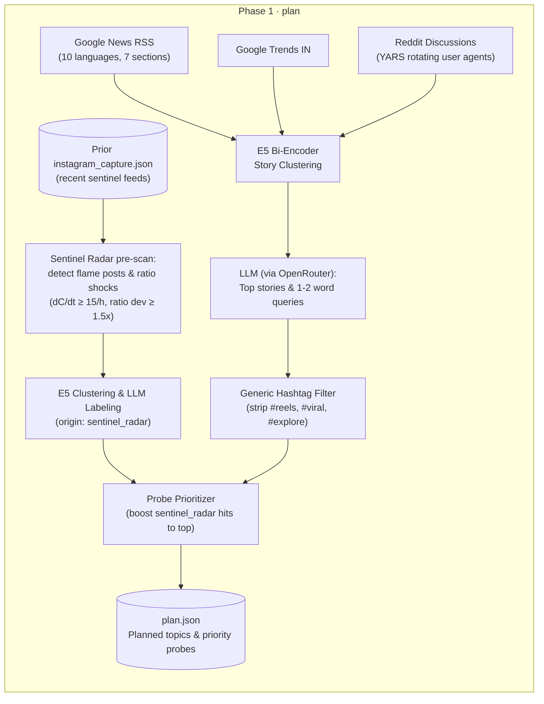

- **News & search clustering**: Google News RSS (10 languages, 7 sections), Google Trends India, and Reddit discussion titles (via YARS with rotating user agents) are embedded and clustered with the E5 bi-encoder, then handed to the LLM to name top stories and produce short 1-2 word Instagram search queries.
- **Sentinel radar pre-scan**: the *previous* run's `instagram_capture.json` is re-scanned with the same flame-post logic used live in Phase 2 (see [3.2](#32-phase-2--collect-no-llm)), so anything already breaking out gets prioritized before this run even starts collecting.
- **Generic hashtag filter**: strips broad tags (`#reels`, `#viral`, `#explore`, `#trending`, `#india`, `#love`, `#instagram`) so the limited search budget in Phase 2 hits story-specific tags instead.
- **Output**: `plan.json`, carrying planned topics and a priority-ordered list of probes (sentinel-radar hits ranked first).

### 3.2 Phase 2 — Collect (no LLM)

Executes every probe against the live Instagram platform and persists raw responses to disk. No LLM calls and no clustering decisions happen in this phase — see the [key invariant](#8-network--operational-topology) in Section 8.

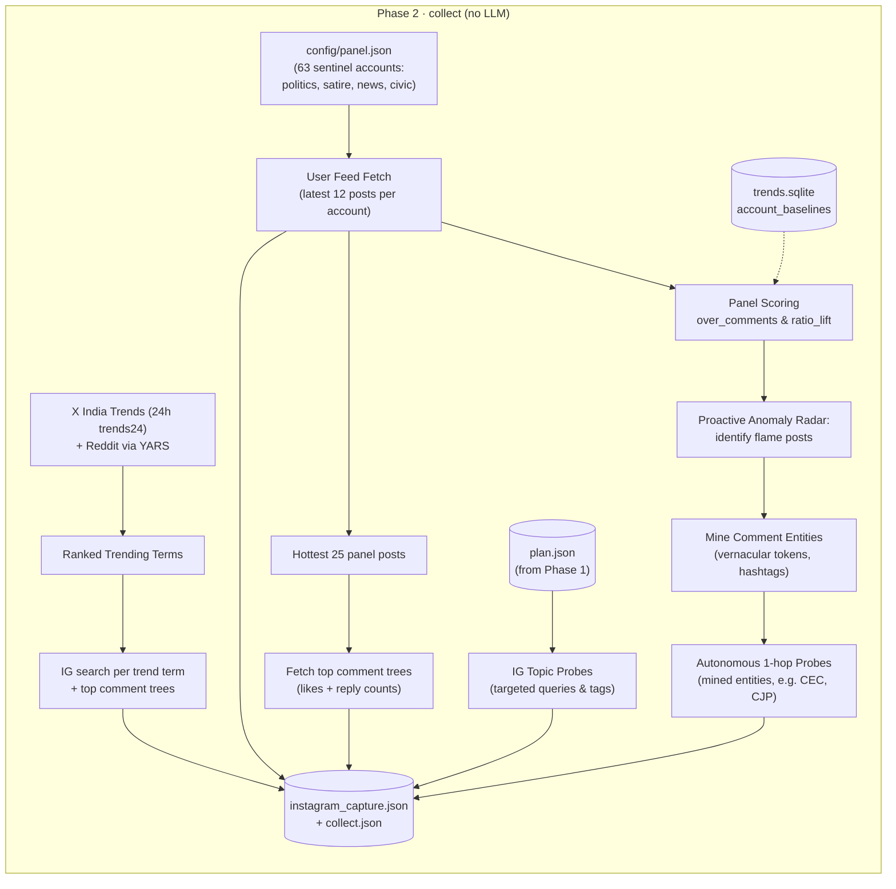

**Lane A — Account Sentinel Panel & baseline normalization.** The panel is 63 curated public accounts in [config/panel.json](config/panel.json), spanning Indian political satire, investigative news, youth commentary, regional meme channels, and civic watchdogs. Every post's performance is measured relative to that account's own historical baseline rather than global counts:

$$\text{over}_c = \frac{c + 5}{\tilde{c}_{acct} \cdot w(a) + 5}, \qquad w(a) = \max\left(0.25, \, \min\left(1, \, \frac{a}{24}\right)\right)$$

where $c$ is the current comment count, $\tilde{c}_{acct}$ is the account's historical median comments on settled posts ($\ge 6$ hours old), $a$ is the post age in hours, and $w(a)$ is an age-attenuation weight reflecting engagement accumulation over a 24-hour cycle (Minot et al. 2021). Baselines persist in the `account_baselines` table of `trends.sqlite` and blend in fresh settled posts each run via sample-weighted exponential smoothing:

$$\tilde{c}_{\text{blended}} = 0.5 \cdot \tilde{c}_{\text{historical}} + 0.5 \cdot \tilde{c}_{\text{batch}}$$

Posts with hidden counts, pinned status, or paid promotional flags are excluded.

**Lane B — Proactive Anomaly Radar & 1-hop probes.** The [proactive_radar.py](src/identify_what_matters/proactive_radar.py) module detects breaking stories at the initial spark phase:

1. **Comment velocity** $\left(\text{velocity} = \Delta\text{comments}/\Delta t\right)$ — posts accumulating $\ge 15$ comments/hour in their initial hours trigger early-warning status.
2. **Ratio shock** $\left(\text{ratio\_lift} = \frac{c / (\ell + 1)}{\tilde{r}_{acct}}\right)$ — posts with a comment-to-like ratio $> 3\sigma$ above the account median are flagged **FLAME**.
3. **Comment entity mining** — the top 50 comments on flame posts are tokenized to extract high-frequency Indic entities, hashtags, and capitalized multi-word phrases. These are queued immediately as autonomous 1-hop search probes within the same collection run, capturing the spread across other accounts before mainstream media coverage begins.

**Lane C — Planned news & trending search probes.** X Trends (24h window, tracked by persistence hours and peak rank) and the `plan.json` queries from Phase 1 drive targeted Instagram searches and comment-tree fetches.

**Output**: `instagram_capture.json` + `collect.json`, holding every raw request/response pair made during this phase.

### 3.3 Phase 3 — Measure

The measurement phase never talks to a live network — it deterministically replays the Phase 2 capture, then runs filtering, clustering, briefing, local ML inference, lifecycle scoring, and persistence. It is split into two diagrams for readability.

**Part A — Ingestion, filtering & clustering:**

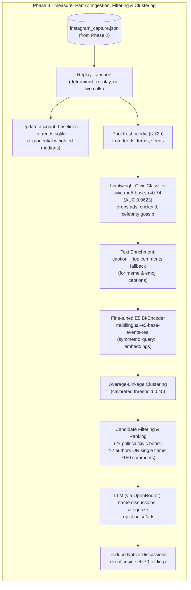

**Part B — Briefing, local ML & lifecycle:**

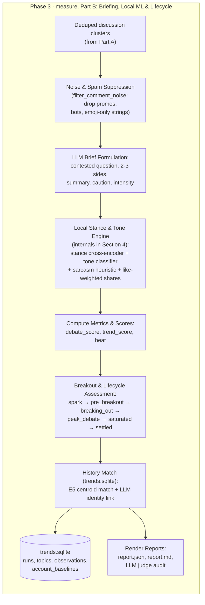

Part A pools fresh media, runs it through the civic pre-filter, enriches meme/emoji-only captions with top comments, embeds and clusters with the fine-tuned E5 bi-encoder, then asks the LLM to name and categorize the surviving candidate clusters, folding near-duplicates. Part B takes those named discussions, strips comment-level noise, asks the LLM to write a contested-question brief with 2-3 sides, then hands that brief to the local Stance & Tone Engine (detailed next in [Section 4](#4-machine-learning--transformer-stack)) before computing scores, assigning a lifecycle stage, matching against topic history, and persisting everything to `trends.sqlite` and the rendered reports.

---

## 4. Machine Learning & Transformer Stack

This section zooms into the **Local Stance & Tone Engine** box from Phase 3, Part B above — the only part of measurement that runs local transformer inference rather than LLM calls or clustering heuristics. It is split into a filtering funnel (which comments even reach the models) and an inference stage (what the models produce).

### 4.1 Filtering Funnel: Civic Pre-Filter & Noise Gates

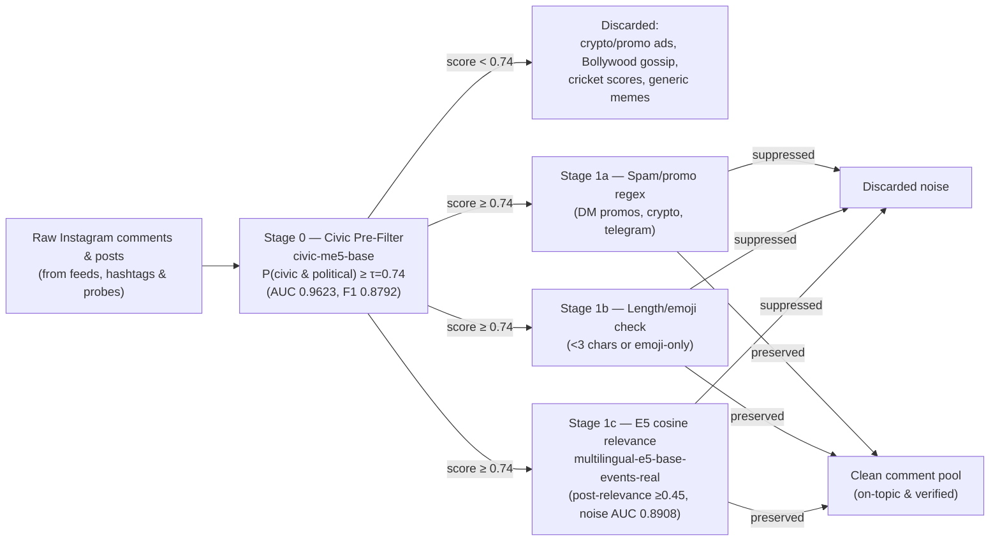

### 4.2 Inference Stage: Stance, Tone & Argument Clustering

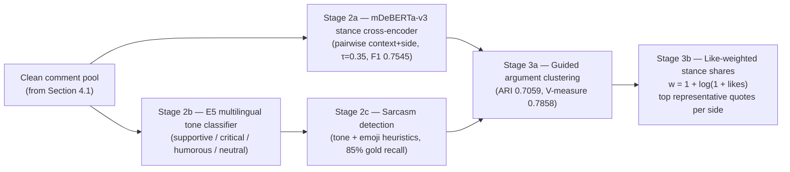

### 4.3 Model & Subsystem Details

#### 4.3.1 Bi-Encoder: `multilingual-e5-base-events-real`
- **Location**: [artifacts/topic-models/multilingual-e5-base-events-real](artifacts/topic-models/multilingual-e5-base-events-real)
- **Architecture**: 768-dimensional multilingual transformer fine-tuned with Multiple Negatives Ranking (MNR) loss.
- **Symmetric Prefix**: Evaluates input strings with the `query: ` prefix.
- **Trained Calibration Threshold**: Cosine distance threshold $\tau = 0.45$ (equivalent to cosine similarity $\ge 0.55$).
- **Performance**:
  - Post-level Story Relevance AUC: **0.9054**
  - Comment-level Noise/Off-Topic AUC: **0.8908**
  - Discussion Clustering Separation: Positive mean similarity $0.6836$ vs. negative mean similarity $0.1699$.

#### 4.3.2 Lightweight Civic & Political Relevance Classifier: `civic-me5-base`
- **Location**: [artifacts/civic-models/civic-me5-base](artifacts/civic-models/civic-me5-base)
- **Training Artifacts & Scripts**: [artifacts/civic_relevance/](artifacts/civic_relevance/), [src/identify_what_matters/civic_classifier.py](src/identify_what_matters/civic_classifier.py)
- **Architecture**: Sequence classification model initialized from `intfloat/multilingual-e5-base` with dynamic class reweighting and calibrated thresholding.
- **Trained Calibration Threshold**: $\tau = 0.74$ (stored in `civic_threshold.json`).
- **Performance on Held-Out Test Set (708 Pairs)**:
  - Test ROC-AUC: **0.9623**
  - Test Macro-$F_1$: **0.8792** (Precision: 0.8740, Recall: 0.8845)
  - Curated Hard Negatives Accuracy: **100%**
  - Regional Language Slices: Bengali ($F_1 = 1.0$), Gujarati ($F_1 = 1.0$), Hindi ($F_1 = 0.8936$), English ($F_1 = 0.9362$), Marathi ($F_1 = 0.8889$), Punjabi ($F_1 = 0.7500$).
- **Role in Pipeline**: Evaluates early post streams before clustering. Pre-emptively weeds out sponsored ad spam, crypto promos, celebrity gossip, and cricket highlights so downstream E5 embeddings and LLM prompts process only genuine civic discourse.

#### 4.3.3 Cross-Encoder Stance Model
- **Location**: [artifacts/stance-models/stance](artifacts/stance-models/stance)
- **Architecture**: Fine-tuned `mDeBERTa-v3-base-xnli-multilingual-nli-2mil7`.
- **Input Pairing**: `(f"{context} || Position: {position}", comment_text)`
- **Calibrated Threshold**: Lowered from initial default $\tau=0.50$ to **$\tau=0.35$** to account for short, colloquial Indic social comments.
- **Validation**:
  - Macro-F1 on real Indic social comments: **0.7545** (improved from 0.6969).
  - Accuracy: **76.04%**.

#### 4.3.4 Tone Model & Sarcasm Heuristic
- **Location**: [artifacts/stance-models/tone](artifacts/stance-models/tone)
- **Architecture**: Fine-tuned `intfloat/multilingual-e5-base` sequence classification head across 4 classes: `supportive`, `critical`, `humorous`, `neutral`.
- **Sarcasm Detection Engine**:
  Real Indian social comments heavily employ irony and sarcasm through Indic rhetorical expressions and emoji markers. Sarcasm is flagged when:
  $$\text{sarcastic} = (c \cap \{\text{😂}, \text{🤣}, \text{😜}, \text{😏}, \text{🤡}, \text{💀}\} \neq \emptyset) \lor (\text{tone} = \text{"humorous"} \land c \text{ contains } \{\text{lol, lmao, sarcasm, waah, kya baat}\})$$
  This captures **85%** of real gold sarcastic comments across testing benchmarks.

#### 4.3.5 Noise Filter Subsystem (`filter_noise` & `filter_comment_noise`)
Before comments are passed to the debate or stance clustering engines, they undergo filtering in [src/identify_what_matters/stance.py](src/identify_what_matters/stance.py):
1. **Length Gate**: Comments $<3$ characters are removed (`too_short`).
2. **Spam & Promotion Gate**: Dropped via compiled regex (`SPAM_REGEX`) targeting giveaways, paid promotion, telegram channels, and crypto spam (`spam_pattern`).
3. **Emoji-Only Gate**: Comments lacking any alphabetic or Indic script Unicode characters are suppressed (`emoji_only`).
4. **Post Relevance Filter**: Media posts collected via broad hashtag searches are compared to the topic anchor using the E5 bi-encoder; posts scoring below cosine $0.45$ are eliminated.

#### 4.3.6 Guided Argument Clustering
Unsupervised raw semantic embeddings struggle on debate comments (yielding an Adjusted Rand Index of only $0.1184$) because commenters on opposing sides share the exact same vocabulary, names, and event context.

The pipeline implements **Cross-Encoder Guided Argument Clustering**:
1. Candidates positions $P = \{p_1, p_2, \dots, p_k\}$ are established from the discussion brief.
2. The fine-tuned cross-encoder scores each clean comment against all candidate positions.
3. Comments with scores exceeding $\tau=0.35$ are assigned to their argmax position; comments below threshold are assigned to `unaligned`.
4. **Benchmark Results**:
   - Adjusted Rand Index (ARI): **0.7059**
   - V-Measure: **0.7858**
   - Normalized Mutual Information (NMI): **0.7858**

#### 4.3.7 Like-Weighted Stance Share Calculation
To prevent brigading from distorting debate representation, opinion shares are weighted by reader endorsements:

$$w_i = 1 + \log(1 + \text{likes}_i)$$

$$\text{Share}(p_k) = \frac{\sum_{i \in \text{Side}_k} w_i}{\sum_{j} w_j}$$

Top representative quotes per side are chosen by highest like count, broken by text length, selecting authentic user comments rather than synthetic summaries.

### 4.4 Bot, Astroturf & Inauthentic Coordination Classifier

Online political debates in India are heavily influenced by orchestrated IT-cell networks, bot farms, and copypasta campaigns. The Bot & Astroturf Detection subsystem ([src/identify_what_matters/bot_detector.py](src/identify_what_matters/bot_detector.py)) operates at both account and campaign levels to determine how much of a discussion is organically driven versus synthetically boosted.

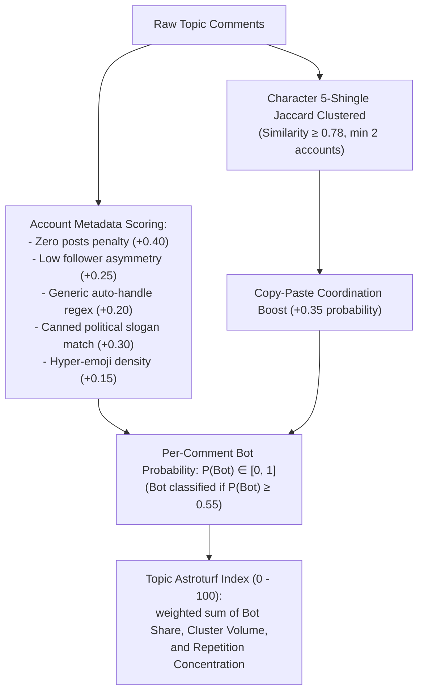

#### Detection Methodology:
1. **Character 5-Shingle Jaccard Clustering**: Deconstructs text into 5-character shingles and computes pairwise Jaccard similarity across comments from distinct handles. Clusters with similarity $\ge 0.78$ reveal automated message broadcasting across handles.
2. **Handle Metadata & Heuristics**:
   - `zero_posts`: Accounts with zero media posts have an immediate baseline bot probability of $0.40$.
   - `follower_asymmetry`: Follower-to-following ratio $< 0.05$ adds $+0.25$.
   - `patterned_usernames`: Handles ending in 4+ random digits (e.g., `@user_849201`) or common spam sequences add $+0.20$.
   - `canned_slogans`: Repetitive partisan slogans (e.g., *"Har Har Modi"*, *"Pappu failed"*, *"EVM hack"*) add $+0.30$.
3. **Debate Breakdown & Side Auditing**: For each contested side in the debate brief, the model measures the proportion of comments originating from bot accounts, exposing which political flank is actively deploying synthetic volume.

### 4.5 Political Favorability Pulse & Socio-Religious Lens Engine

The Political Favorability and Socio-Religious Cross-tab engine ([src/identify_what_matters/political_pulse.py](src/identify_what_matters/political_pulse.py)) replaces administrative ticketing with real-time ideological alignment tracking.

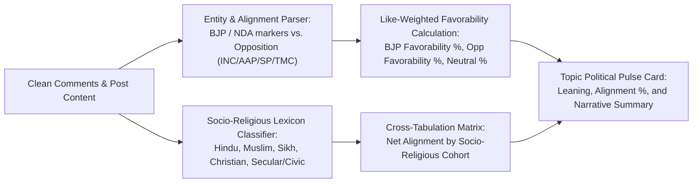

#### Core Components:
1. **Bilingual Partisan Lexicon**: Contains extensive Hindi and English political expressions, party leadership names, policy catchphrases, and critical epithets.
2. **Net Favorability Calculation**:
   $$\text{Favorability}_{\text{BJP}} = \frac{\sum_{i \in \text{BJP Support}} w_i + \sum_{j \in \text{Opp Critique}} w_j}{\sum_{\text{all}} w_k}$$
   $$\text{Favorability}_{\text{Opp}} = \frac{\sum_{i \in \text{Opp Support}} w_i + \sum_{j \in \text{BJP Critique}} w_j}{\sum_{\text{all}} w_k}$$
3. **Socio-Religious Cross-Tabulation**: Maps discourse across five distinct demographic lenses (`hindu`, `muslim`, `sikh`, `christian`, `secular_civic`) based on community-specific cultural tokens, festival references, script choices, and demographic identifiers. The output reveals how policy flashpoints resonate differentially across communities.

---

## 5. Lifecycle Trajectory & Breakout Assessment

Every topic is tracked across runs and assigned a lifecycle state based on engagement velocity and coverage spread:

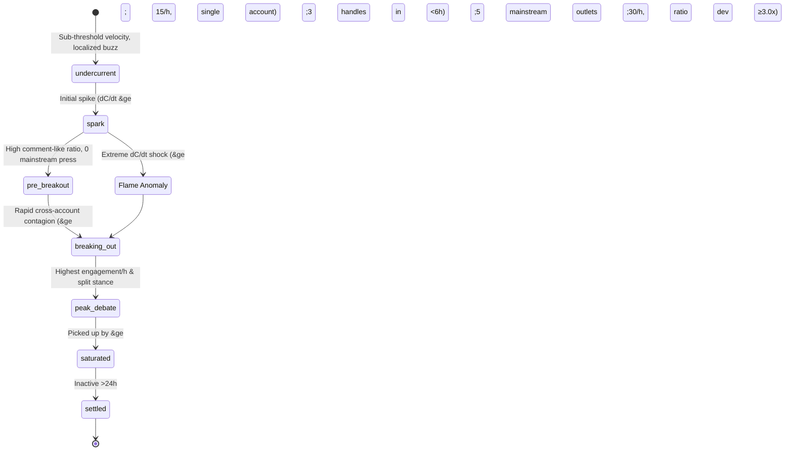

### Comprehensive Topic Lifecycle Statuses:

| Status Code | Stage Name | Definition & Quantitative Trigger | Typical Media vs. Social Dynamic |
| :--- | :--- | :--- | :--- |
| **`undercurrent`** | Simmering Undercurrent | Grassroots topic actively debated on regional Instagram meme pages or niche subreddits (e.g. r/india, r/indiadiscussion) with growing comment count ($>50$ comments) but undetected by national news wires ($0$ RSS articles). | Social-exclusive; institutional media unaware. Ideal for early strategic awareness. |
| **`spark`** | Initial Ignition | High initial acceleration on a single panel account or niche hashtag ($dC/dt \ge 15\text{ comments/hr}$). | Single-creator anomaly or local incident. |
| **`flame`** | Flame Anomaly | Hyper-accelerating post with extreme engagement shock ($dC/dt \ge 30\text{ comments/hr}$ and comment-to-like ratio deviation $\ge 3.0\sigma$ above creator's 30-day baseline). | Polarized breaking event triggering viral outrage or applause. |
| **`pre_breakout`** | Pre-Breakout | Sustained ratio lift ($>2.5\times$ account median) and heavy comment volume, with zero mainstream news publishers. High debate friction. | Pre-newsroom contagion. Community arguments reach saturation locally. |
| **`breaking_out`** | Rapid Contagion / Breakout | Topic spreads horizontally across $\ge 3$ distinct creator handles within a 6-hour window. Velocity score $>0.75$. | Leaping from niche pages into general public consciousness; press wires begin tracking. |
| **`rising`** | Broadening Momentum | Expanding multi-platform coverage across Instagram, Reddit, and initial digital news publishers with accelerating total shares. | Mainstream aggregation begins; YouTube and TV debate panels catch wind. |
| **`peak_debate`** | Peak Polarization | Highest engagement per hour, balanced opposing argument sides ($1 - \|s_1 - s_2\| \ge 0.60$), and active reply threads. | National debate primetime; official party spokespersons and PR teams engaged. |
| **`saturated`** | News Saturated | Story picked up across $\ge 5$ mainstream news publishers; Instagram comments shift from original arguments toward repetitive or bot reactions. | Editorial consensus reached; organic debate decelerating. |
| **`cooling`** | Decelerating Interest | Engagement velocity drops below 25% of peak; comment rate decreases steadily ($dC/dt < 5/\text{hr}$). | Attention drifting to newer breaking stories. |
| **`settled`** | Settled / Archived | Zero new posts or significant comment velocity recorded in $>24\text{ hours}$. | Story archived; historical record persisted in `trends.sqlite`. |

---

## 6. Storage Schema (`output/trends.sqlite`)

The pipeline maintains persistent state in SQLite across runs. `runs` and `topics` are linked through `observations` (one row per topic per run); `account_baselines` is a standalone table keyed by account handle, updated independently in Phase 2 and Phase 3.

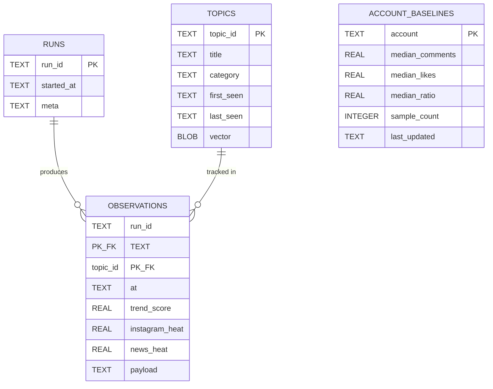

- **`runs`**:
  ```sql
  CREATE TABLE runs (
      run_id TEXT PRIMARY KEY,
      started_at TEXT,
      meta TEXT
  );
  ```
- **`topics`**:
  ```sql
  CREATE TABLE topics (
      topic_id TEXT PRIMARY KEY,
      title TEXT,
      category TEXT,
      first_seen TEXT,
      last_seen TEXT,
      vector BLOB
  );
  ```
  *Note: `vector` stores the fine-tuned 768-dimensional float32 E5 centroid vector for cross-run topic matching.*
- **`observations`**:
  ```sql
  CREATE TABLE observations (
      run_id TEXT,
      topic_id TEXT,
      at TEXT,
      trend_score REAL,
      instagram_heat REAL,
      news_heat REAL,
      payload TEXT,
      PRIMARY KEY (run_id, topic_id)
  );
  ```
- **`account_baselines`**:
  ```sql
  CREATE TABLE account_baselines (
      account TEXT PRIMARY KEY,
      median_comments REAL,
      median_likes REAL,
      median_ratio REAL,
      sample_count INTEGER,
      last_updated TEXT
  );
  ```

---

## 7. End-to-End Data Flow (Sequence Diagrams)

The full pipeline sequence is split into one diagram per phase (plus a part A/B split for the longer measurement phase) so each diagram fits on screen and only shows the participants relevant to that phase.

### 7.1 Sequence — Phase 1: Plan

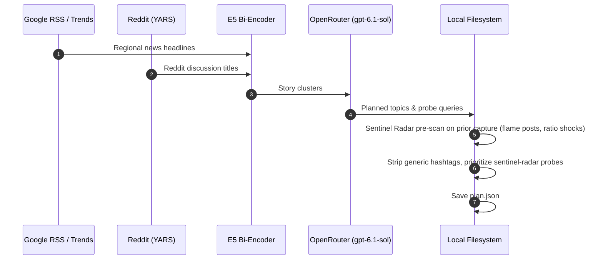

### 7.2 Sequence — Phase 2: Collect

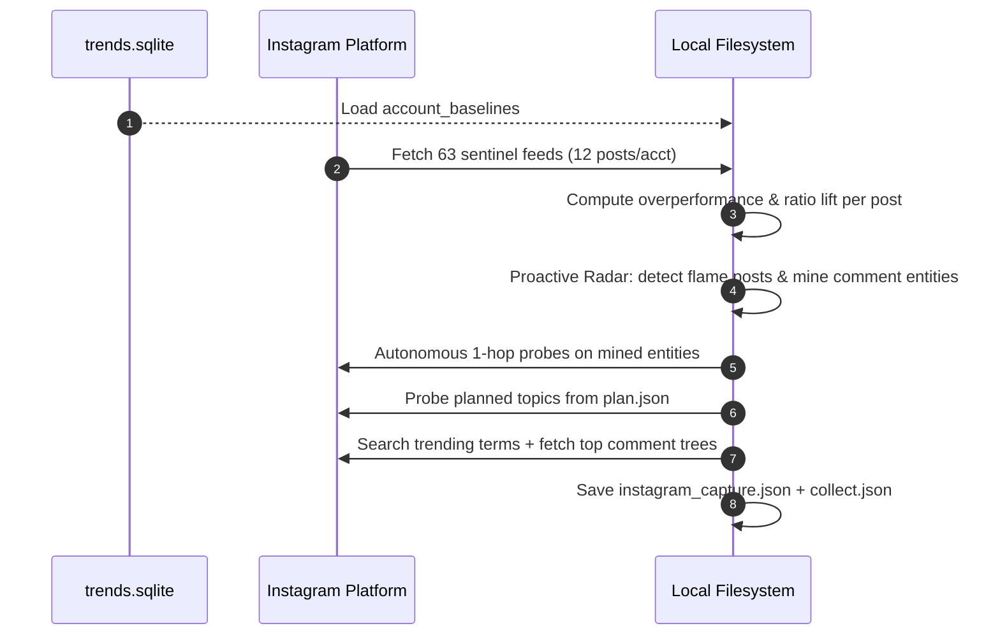

### 7.3 Sequence — Phase 3, Part A: Ingestion, Filtering & Clustering

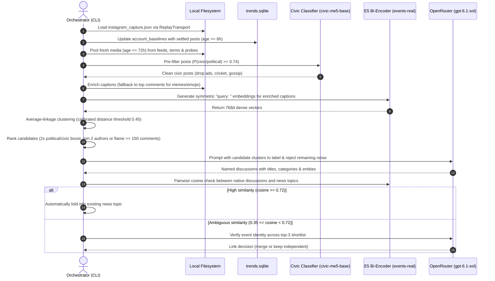

### 7.4 Sequence — Phase 3, Part B: Briefing, Local ML & Persistence

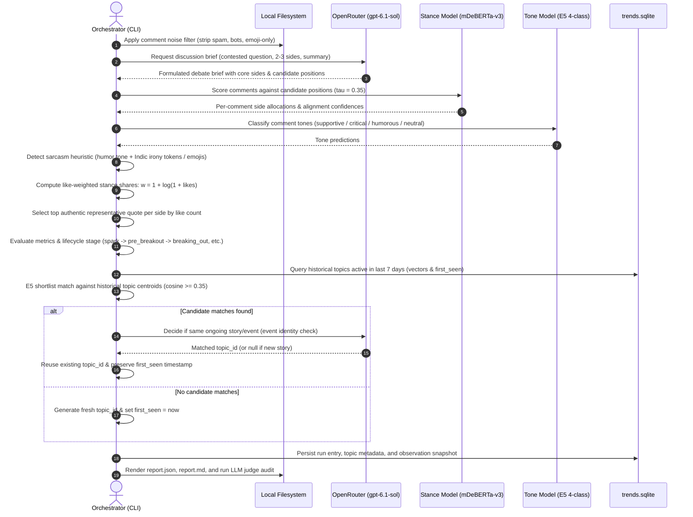

---

## 8. Network & Operational Topology

All LLM operations are powered by OpenRouter's publicly available API, removing any corporate VPN or dual-network requirements. The entire system runs directly over standard internet access:

| Phase | Network Requirement | Operations & Endpoints | Output Artifacts |
| :--- | :--- | :--- | :--- |
| **`plan`** | Internet | Google News RSS, Google Trends, OpenRouter LLM, Sentinel Radar on prior capture | `plan.json`, `signals.json`, `stories.json` |
| **`collect`** | Internet / Local Bridge | X Trends, Reddit, Instagram (Private API, Mock, or Browser Bridge) | `instagram_capture.json`, `collect.json` |
| **`measure`** | Offline / Local Compute | ReplayTransport, Local E5 & mDeBERTa Models, OpenRouter LLM, SQLite | `report.md`, `report.json`, `instagram.json`, `trends.sqlite` |

### Key Invariant:
`collect` executes **zero LLM calls** and makes no non-deterministic decisions; all raw network responses are persisted to disk. `measure` replays this capture deterministically via `ReplayTransport`, enabling offline tuning, calibration, and auditing without touching live network services.

---

## 9. Research Basis

| Source | Concept Applied |
| :--- | :--- |
| **J. Hessel, L. Lee.** *Something's Brewing! Early Prediction of Controversy-causing Posts from Discussion Features.* NAACL 2019. | Controversy as content that splits a community ($1 - \|s_1 - s_2\|$). Early comment-tree structure predicts sustained debate and transfers across diverse linguistic communities. |
| **J. Minot et al.** *Ratioing the President.* PLOS ONE 16(4), 2021. | Reply-vs-endorsement "ratios" as an objective proxy for contested posts. Activity stabilizes on a 24-hour cycle, informing the $w(a)$ time attenuation formula. |
| **K. Garimella et al.** *Quantifying Controversy on Social Media.* ACM TSC. | Controversy is quantified more accurately from conversation and comment structure than text alone. |
| **J. Kleinberg.** *Bursty and Hierarchical Structure in Streams.* KDD 2002. | Infinite-state automaton model for identifying burst states in time-series social event streams. |
| **Z. Tufekci.** *Big Questions for Social Media Big Data.* ICWSM 2014. | Analysis of purposive panel selection bias vs. open platform firehose sampling. |
| **S. Vosoughi et al.** *The spread of true and false news online.* Science 2018. | Misinformation spreads faster than verified news; motivating the automated caution flag and LLM judge audit. |
| **CrowdTangle Overperformance Normalization.** | Evaluating social posts against historical running medians rather than absolute metrics. |

