# Identify What Matters: System Overview

A visual guide to the models in this project, what each one does, and what the dashboard can do with them.

---

## 1. What the System Does

The system finds civic and political discussions in India that are gaining momentum, measures how people disagree about them, and presents the result in an interactive dashboard.

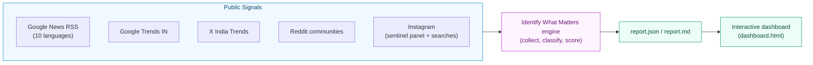

---

## 2. Models at a Glance

The system combines a few fine-tuned language models, several lightweight classifiers, and an external LLM for summarization.

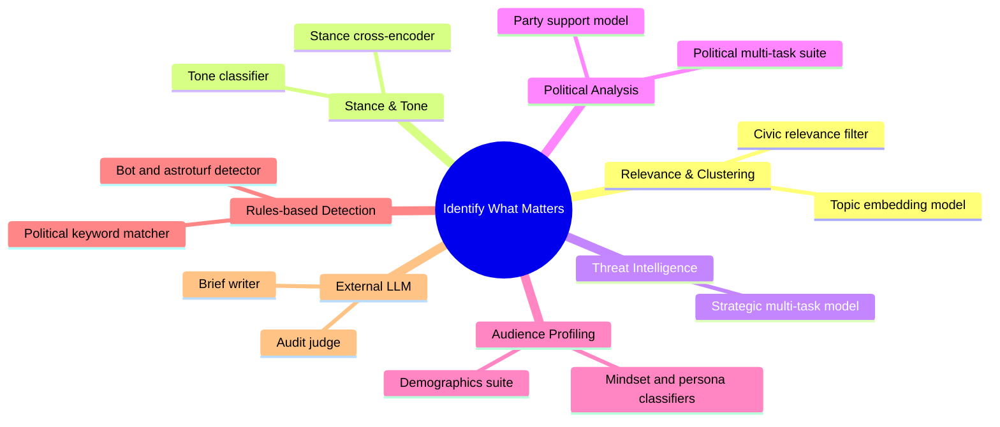

### Model Registry

| Model | What it does | Headline result |
| :--- | :--- | :--- |
| **Topic embedding model** (multilingual sentence encoder, fine-tuned) | Turns posts into vectors so that posts about the same event group together | Relevance ROC-AUC about 0.91 |
| **Civic relevance filter** (multilingual sentence encoder, fine-tuned) | Removes sports, entertainment, and ads before analysis | ROC-AUC about 0.96 |
| **Stance cross-encoder** (multilingual transformer, fine-tuned) | Decides whether a comment supports or opposes each side of a debate | Macro-F1 about 0.75 |
| **Tone classifier** (fine-tuned multilingual model) | Labels comments as supportive, critical, humorous, or neutral | Accuracy about 0.77 |
| **Strategic multi-task model v4** (multi-head transformer, fine-tuned) | Predicts threat axis, criticality, authenticity, and lifecycle stage in one pass | Axis accuracy 93.3%, authenticity 95.5% |
| **Political multi-task suite** (6 tasks) | Tags relevance, issue cluster, sentiment, target, direction, and narrative type | Transformer `is_political` about 0.89 F1 |
| **Party support model** (multilingual transformer, fine-tuned) | Estimates the party alignment expressed in commenter text | Accuracy 82% |
| **Demographics and mindset suite** (6 classifiers) | Estimates age cohort, gender, mental-state archetype, impatience, irrationality, and party support | Macro-F1 0.75 to 0.97 across tasks |
| **Bot and astroturf detector** (rules plus neural score) | Finds copy-pasted comments and coordinated accounts | Used as a penalty in scoring |
| **External LLM** (via OpenRouter) | Writes debate briefs and audits claims against source evidence | Used for synthesis only |

---

## 3. Three-Phase Pipeline

The pipeline separates data collection from analysis. Collection makes no model-driven decisions, so each run can be replayed offline.

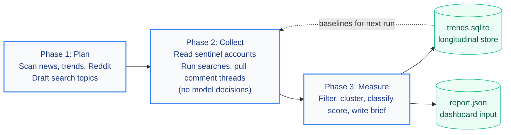

### Phase 3 in Detail

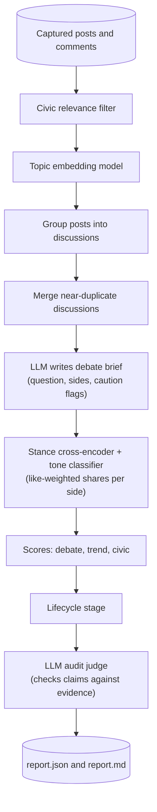

---

## 4. Model Roles in a Single Discussion

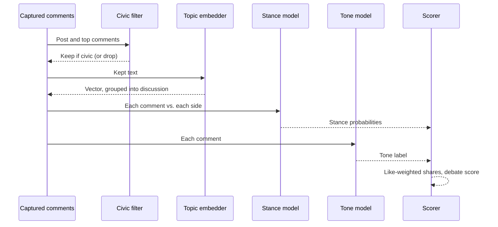

---

## 5. Lifecycle Stages

Each discussion is assigned a stage from its current evidence on every run.

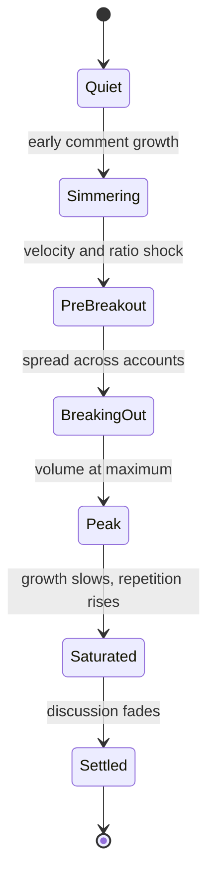

The stage is recomputed on each run from current evidence. It is not stored as a tracked transition.

---

## 6. Scoring

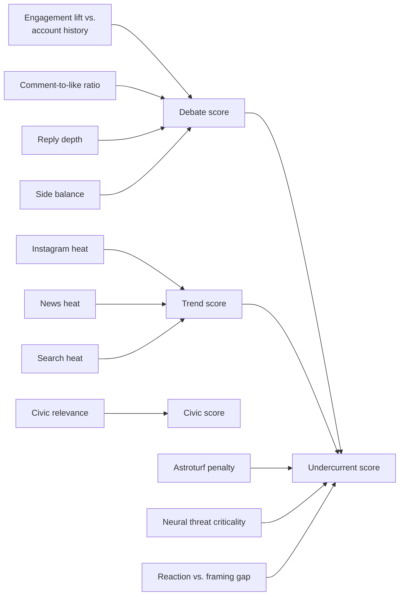

| Score | Meaning |
| :--- | :--- |
| `debate_score` | How strongly people disagree |
| `trend_score` | Cross-platform momentum |
| `civic_score` | How much the discussion is about governance |
| `undercurrent score` | Ranking of subterranean political friction |

---

## 7. Political and Demographic Analysis

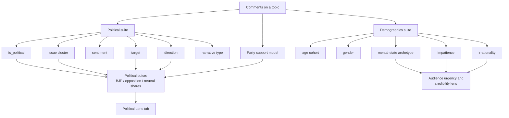

Demographic outputs are aggregate, population-level signals. They are not used to identify individuals.

---

## 8. Dashboard

The dashboard is generated from `report.json` by `make_full_dashboard.py`.

```mermaid
mindmap
  root((dashboard.html))
    Overview
      Threat axes
      Critical friction signals
      Breakout radar bubble chart
      Stage and category distribution
    All Topics
      Filterable cards
      2D debate radar
      Like-weighted opinion splits
    Civic and Political
      13 issue clusters
      Incumbent lean
      Targets and narratives
      Source authenticity filtering
    Undercurrent
      Subterranean friction ranking
      Framing vs. reaction gap
      Bot-discounted scores
    Panel Pulse
      Sentinel account activity
      High-reach (>200K) influencer tracking
      Influencer sentiment alignment
      Suburban swing early warning
      Comment-to-like ratio shocks
    Political Lens
      Strategic action recommendations feed
      Narrative penetration rate (NPR)
      Demographic swing potential matrix
      Issue-to-action policy gap detector
      Opposition vulnerability capitalization windows
      Party favorability pulse
      Socio-religious cross-tabs
    Reddit
      Subreddit signals
      Hot and top thread sentiment
```

### Topic Drawer

Each topic opens a drawer with:

- Brief, caution flags, and audit status
- **True Sentiment (Bot-Adjusted)** toggle and dual-layer hatched bar separating human grassroots sentiment from synthetic bot skew
- Opinion split by side, with example comments
- Audience urgency and credibility badges
- Source attribution for post framing and comment reaction

### 8.1 Bot vs. Organic Sentiment & Coordination Radar

To prevent political leadership and analysts from over-reacting to manufactured social media controversies, the platform provides dedicated authenticity separation:

1. **Dedicated Bot vs. Organic Sentiment Split KPI Cards**:
   - Compares **Organic Sentiment Mix** (derived strictly from verified human commenters: Supportive %, Critical %, Neutral %, Non-partisan %) directly against **Bot/Synthetic Sentiment Mix** (canned campaign slogans, extreme partisan attacks, artificial polarization).
   - Generates a real-time **Astroturf Skew Delta** and diagnostic verdict (`🚨 Artificial Astroturfed Attack` vs `⚠️ Genuine Grassroots Discontent` vs `✅ Authentic Civic Discourse`).

2. **Bot-Adjusted Sentiment Bars**:
   - Dual-layer sentiment bar within topic expansion drawers: renders true human sentiment alongside a hatched overlay segment illustrating the volume driven by automated bot clusters.
   - Interactive toggle switching between raw blended public sentiment and bot-adjusted organic sentiment.

3. **Source Authenticity Filter in Global Controls**:
   - Controls panel dropdown enabling one-click filtering across `[ All Comments (Blended) ]`, `[ Verified Organic Only ]`, and `[ Flagged Synthetic / Bot Clusters Only ]`.

4. **Semantic Bot-Cluster Sentiment Matrix Table**:
   - Enriches repeated copy-paste comment templates with explicit **Synthetic Lean & Political Vector** (e.g. `🟠 100% Pro-Incumbent / Nationalist`, `🔵 100% Anti-Incumbent / Opposition`) and **Dominant Sentiment**, mapping exact bot scripts directly to their partisan source.

### 8.2 Prescriptive Analytics for Political Leadership

Moves the system from a descriptive monitor ("what people are saying") to a prescriptive tactical engine ("what action political leadership should take next"):

1. **Narrative Vulnerability & Friction Mapping (NPR Tracker)**:
   - Measures the **Narrative Penetration Rate (NPR)**: the velocity with which an opposition talking point spreads outside its echo chamber into neutral or supportive voter cohorts.
   - Triggers automated alerts with targeted counter-narrative recommendations within 24-48 hour response windows.

2. **Demographic & Geographic Swing Potential Matrix (Persuadability Index)**:
   - Computes a dynamic **Persuadability Score (0-100)** across key voter segments (18-24 Suburban Youth, 25-34 Working Professionals, Semi-Urban Women 35-54, Rural Agrarian Youth, Regional Diaspora).
   - Specifies optimal resource allocation: candidate physical travel locations, town hall subjects, and high-ROI digital ad micro-targeting.

3. **Issue-to-Action Translation (The "Policy Gap" Detector)**:
   - Measures **Grievance-to-Policy Alignment**: cross-references public anxiety share against leadership communication share across 14 issue clusters.
   - Highlights critical communication disconnects (e.g. public anxiety on exam integrity up 40% with only 6% communication share) and prescribes specific talking point injections.

4. **Opposition Vulnerability & Counter-Attack Window Tracker**:
   - Measures the **Opposition Backlash Index (OBI)** on opposition statements, candidate gaffes, and regional coalition disputes.
   - Identifies active **Capitalization Windows** (<12h immediate, 24-48h) to transition campaign strategy from defensive response to offensive contrast.

5. **Strategic Leadership Action Recommendation Feed**:
   - A unified executive command feed prioritizing actions (`High 🔴`, `Medium 🟡`, `Low 🟢`) by Trigger Event, Target Audience, and Recommended Leadership Action.

6. **Influencer Sentiment Alignment & Suburban Swing Predictor**:
   - Tracks opinionated creator accounts with >200K followers to assess net favorable/critical slant and tone shift as an early indicator of wider suburban voter swings.

---

## 9. Capabilities

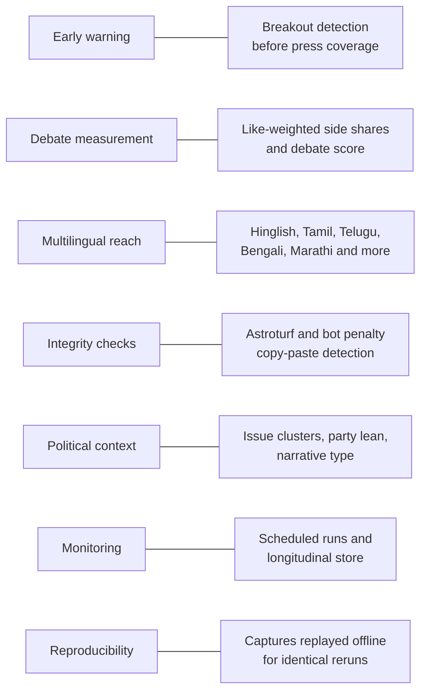

---

## 10. Running the System

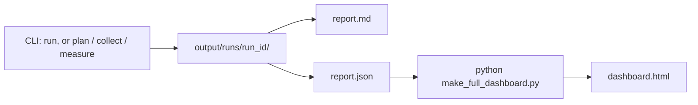

---

## 11. Long-Term Roadmap: From Monitor to Civic Intelligence Platform

The current system answers one question: what is being debated, and how strongly. The platform is designed to grow into a broader intelligence layer. Items below are planned, not built. Solid boxes are current; dashed boxes are planned.

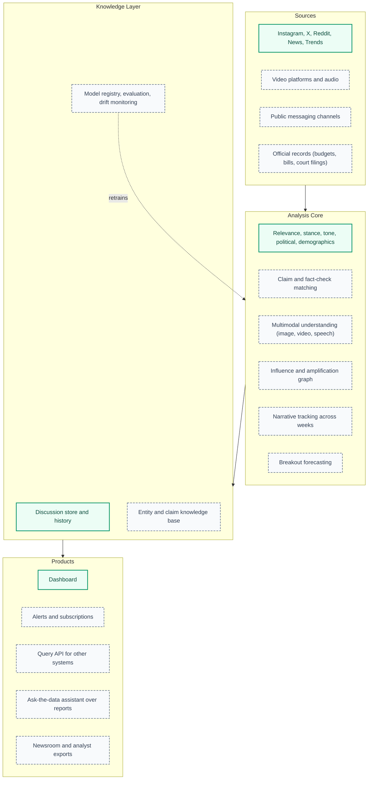

### 11.1 Additional Models

| Model or capability | Purpose | Why it matters beyond sentiment |
| :--- | :--- | :--- |
| **Claim extraction and matching** | Identifies factual claims in posts and links them to published fact-checks | Separates a dispute about facts from a dispute about values |
| **Multimodal understanding** | Reads on-screen text, image content, and video speech | Much of the discourse on short-form video is not in captions |
| **Speech recognition for regional languages** | Transcribes audio in Indian languages and code-mixed speech | Opens video and voice notes to the same analysis as text |
| **Influence and amplification graph** | Maps which accounts seed and which amplify a narrative | Distinguishes organic spread from coordinated push |
| **Narrative tracking** | Follows a storyline across weeks and platforms | Shows how an issue mutates, not only its peak |
| **Breakout forecasting** | Estimates the probability that a discussion crosses into mainstream coverage | Turns early warning into a measured forecast |
| **Entity resolution** | Maps names, aliases, and handles to a single person, party, or organization | Makes target-level analysis consistent across sources |
| **Geographic analysis** | Aggregates signals by state, district, and language region | Surfaces local issues that national views hide |
| **Stance drift monitoring** | Detects when public stance on an issue shifts | Flags real opinion change versus a change in who is talking |
| **Anomaly detection on panels** | Learns normal activity per account and per topic | Reduces reliance on hand-set thresholds |

### 11.2 Additional Data Sources

- **Video platforms**: public video metadata, comments, and transcripts, subject to each platform's terms.
- **Official records**: parliamentary proceedings, court listings, and government notifications, used as ground truth for claims.
- **Public channels**: openly accessible broadcast-style channels, with clear consent and terms review before use.
- **Newsroom feeds**: partner RSS and editorial feeds for faster matching of coverage to discussion.
- **Human annotation**: analyst labels collected through a review queue, used to retrain and recalibrate models.

### 11.3 Additional Solutions

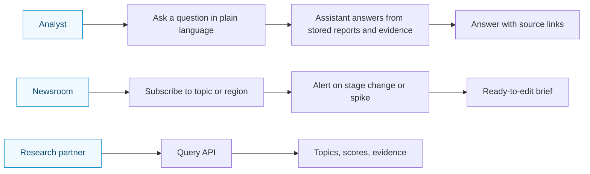

- **Ask-the-data assistant**: answers questions over stored reports, always with links to evidence.
- **Alerts and subscriptions**: notifications when a topic changes stage, crosses a score, or appears in a chosen region.
- **Query API**: read access to topics, scores, and evidence for partners and internal tools.
- **Scenario and playbook generator**: drafts response options for each issue, reviewed by a human before use.
- **Exports**: formatted briefs and data extracts for editorial and research workflows.

### 11.4 Platform Foundations

These make the models maintainable as their number grows.

- **Model registry**: every model has an owner, version, training data lineage, and a model card.
- **Evaluation harness**: a fixed gold benchmark runs on every candidate model before promotion.
- **Drift monitoring**: tracks input distribution and accuracy over time, and flags models for retraining.
- **Fairness and bias audits**: measures error rates across languages, regions, and topic types.
- **Human review queue**: analysts correct labels and flagged outputs, feeding the next training cycle.
- **Access control and audit log**: role-based access to dashboards, exports, and the API.
- **Modular analysis stages**: each model sits behind a common interface, so one can be replaced without changing the pipeline.

### 11.5 Suggested Sequencing

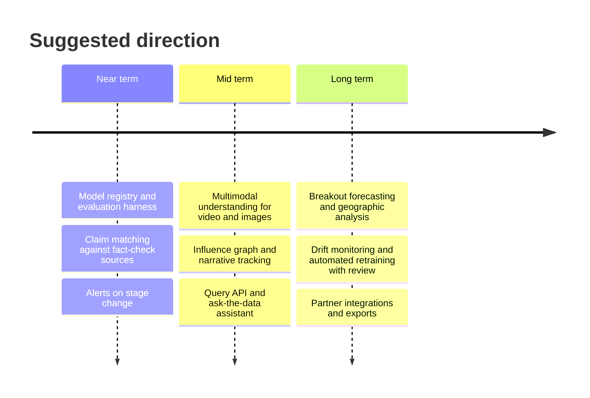

---

## 12. Limits and Safeguards

- Discussion classifiers were trained on a mix of real and synthetic labelled data, so results can drift on new topics.
- Phase 2 makes no LLM or model decisions, so collection results are reproducible.
- Handles, phone numbers, and URLs are removed before text goes to an LLM.
- Briefs present balanced debate questions rather than partisan conclusions.
- No personal attributes such as caste or religion are inferred from usernames or text.
- Every brief is checked by an automated audit against source evidence.

---

## 13. Model Development History

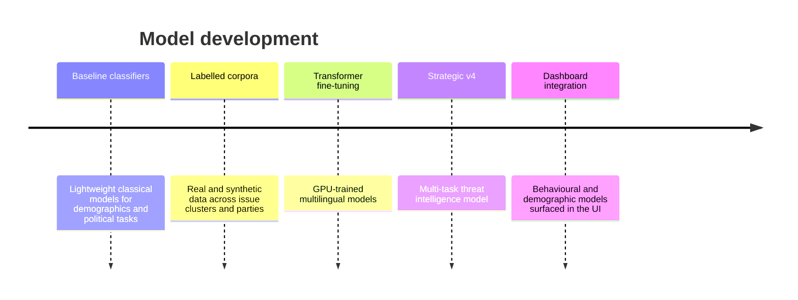
